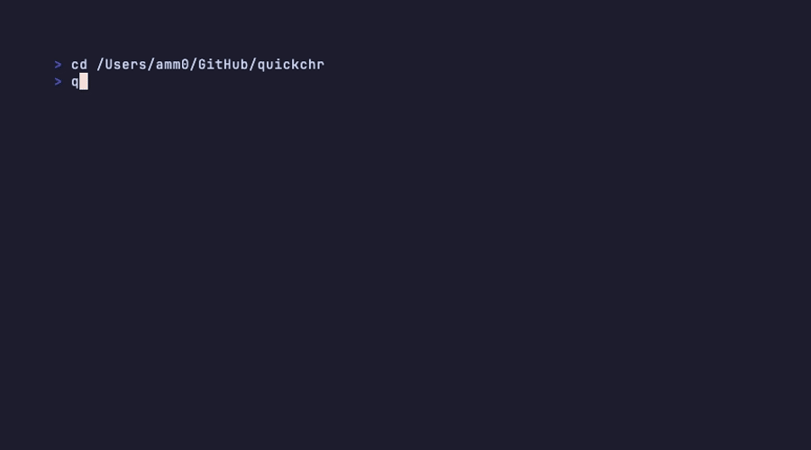
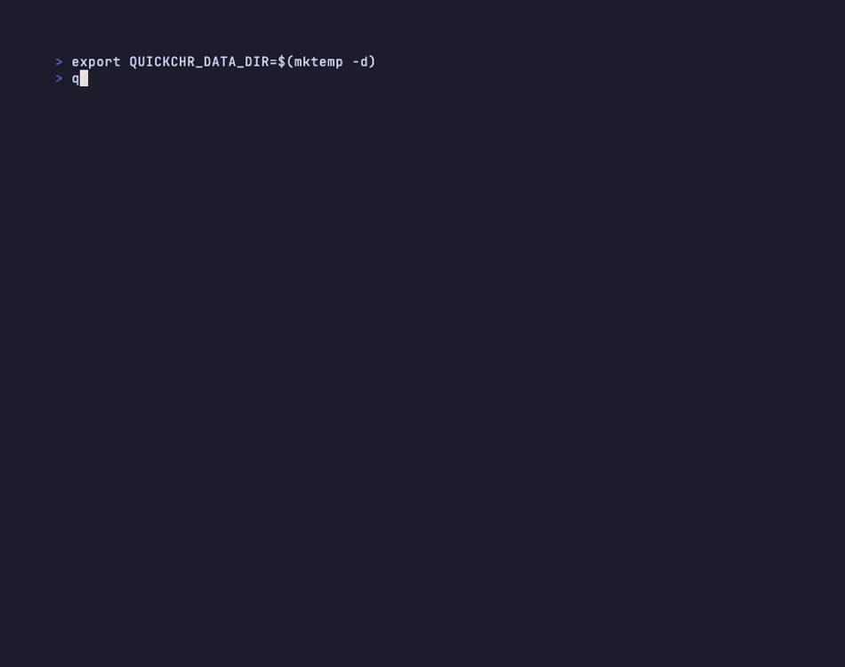

# quickchr Manual

> Audit-style reference for what quickchr actually does today. README is the
> elevator pitch and quickstart; DESIGN.md is the architecture rationale;
> this MANUAL is the complete, source-checked map of every CLI command,
> library API, and provisioning step.

## Table of Contents

1. [What quickchr is](#1-what-quickchr-is)
2. [Install & doctor](#2-install--doctor)
3. [CLI command reference](#3-cli-command-reference)
4. [Library API reference](#4-library-api-reference)
5. [Provisioning pipeline](#5-provisioning-pipeline)
6. [Channels — REST, monitor, serial, QGA, console](#6-channels--rest-monitor-serial-qga-console)
7. [Networking](#7-networking)
8. [Storage layout](#8-storage-layout)
9. [Port layout](#9-port-layout)
10. [Acceleration & timeouts](#10-acceleration--timeouts)
11. [Auth, secrets, environment variables](#11-auth-secrets-environment-variables)
12. [Exec — running RouterOS commands](#12-exec--running-routeros-commands)
13. [Disks & snapshots](#13-disks--snapshots)
14. [Errors & recovery](#14-errors--recovery)
15. [Cross-references](#15-cross-references)

---

## 1. What quickchr is

A **CLI plus importable library** for managing MikroTik CHR (Cloud Hosted
Router) virtual machines on macOS, Linux, and (experimentally) Windows.
quickchr wraps QEMU directly — it is **not** an orchestrator. Each
invocation manages one CHR instance; multi-router topologies are composed
by the user (or their AI agent) using `quickchr` as a building block.

**Scope boundary** (see DESIGN.md §Scope Boundary):

- ✅ Download CHR images, manage QEMU lifecycle, expose REST/SSH/WinBox
  ports, persist machine state, run RouterOS CLI commands, install
  packages, apply trial licenses, switch device-mode.
- ❌ Multi-router topology orchestration, test-matrix runners,
  configuration-as-code DSLs. Use `examples/` as references and compose
  yourself.
- ⚠️ **RouterOS 6** is a best-effort, boot-only target (x86, CLI only): quickchr
  downloads, boots and tracks a 6.x CHR, and does nothing else to it. It exists so
  v6→v7 migration tooling has a disposable 6.x router to test against — it is not
  RouterOS 6 support. See [RouterOS 6](#routeros-6-boot-only) below.

**Two ways to use it:**

- `quickchr <command>` — the CLI. Git-style subcommands plus an interactive
  setup wizard (`quickchr setup`).
- `import { QuickCHR } from "@tikoci/quickchr"` — the library. Returns
  `ChrInstance` handles for programmatic control.

---

## 2. Install & doctor

### Prerequisites

| Component | Required for | Install |
|---|---|---|
| Bun ≥ 1.1 | runtime | macOS/Linux: `curl -fsSL https://bun.sh/install \| bash` · Windows: `powershell -c "irm bun.sh/install.ps1 \| iex"` (or `winget install Oven-sh.Bun`) |
| `qemu-system-x86_64` | x86 CHR | brew/apt/dnf/pacman · Windows: `winget install SoftwareFreedomConservancy.QEMU` |
| `qemu-system-aarch64` | arm64 CHR | brew/apt/dnf/pacman · Windows: bundled in the SFC QEMU package above |
| `qemu-img` | Default qcow2 creation, setup wizard, `--boot-size`, `--add-disk`, snapshots | included in all standard QEMU packages (brew, apt, dnf, SFC installer) |
| UEFI firmware (edk2) | arm64 CHR | `qemu-efi-aarch64` (apt), `edk2-aarch64` (dnf), bundled with `qemu` (brew) |
| `socket_vmnet` (optional) | rootless `shared`/`bridged` networking on macOS | `brew install socket_vmnet` |
| `socat` (optional) | piping serial console externally | brew/apt |
| `sshpass` (optional) | future SSH exec transport | brew/apt |

### Install quickchr

Install the stable npm channel:

```bash
bun install -g @tikoci/quickchr
bun add @tikoci/quickchr
```

For prerelease QA, use `@next` for the current candidate or, after publication,
`@0.5.1` to pin this candidate. A release is published to `next` first and promoted
to `latest` once QA passes; `next` is never older than `latest`. The quickchr package
channel is independent of `--channel`, which selects a RouterOS firmware channel.

```bash
bun install -g @tikoci/quickchr@0.5.1
bun add @tikoci/quickchr@0.5.1
quickchr --version
```

To run an unpublished checkout:

```bash
git clone https://github.com/tikoci/quickchr
cd quickchr
bun install
bun run dev -- doctor
```

### `quickchr doctor`

Reports prerequisite status, accelerator availability, image cache
size, machine count, free disk space, and shell-completion install
state. The disk check measures the data dir's filesystem and warns when free
space is under `storage-reserve` + 2 GiB. Exit code is `0` when no checks return
`error` (warnings are OK).

```bash
quickchr doctor              # human-readable
quickchr doctor --json       # { ok, checks, staleImages } for CI
```

The `--json` form emits `{ ok, checks, staleImages }`, where `checks` is an
array of `{ label, status, detail }` and `staleImages` lists cached images older
than the current long-term release. The exit code still reflects `ok`.

`doctor` reports the tested Bun pin and warns when the running runtime is older.



Use this whenever a `start` fails — the diagnostic almost always points
at a missing dependency, missing firmware, or insufficient disk.

### Claude Code cloud sessions and other proxied sandboxes

quickchr runs in a Claude Code cloud session (claude.ai/code, the Claude app's
cloud environments), but the defaults need two changes. The constraints there are
typical of CI sandboxes generally:

| Constraint | Effect on quickchr |
|---|---|
| No `/dev/kvm` | TCG only. `detectAccel()` picks it automatically; no `QUICKCHR_ACCEL` needed |
| All egress goes through an HTTPS proxy (`HTTPS_PROXY`) | Bun's `fetch` honours it. Image downloads work only if the proxy allows the MikroTik hosts |
| Default "Trusted" network policy | `download.mikrotik.com` and `upgrade.mikrotik.com` are refused: the proxy answers `403` to CONNECT and quickchr reports `ERR_PROXY_TUNNEL` |
| QEMU not preinstalled | Ubuntu mirrors are allowed even on "Trusted", so `apt-get` works |
| CHR guest uses user-mode NAT, which bypasses the proxy | The CHR itself has no internet: no package downloads, container pulls or online catalogs from inside RouterOS. Host ↔ guest traffic (port forwards, and the guest reaching the host at `10.0.2.2`) still works |

**1. Network access.** Network policy belongs to the *environment*. To change it,
open the environment menu in the session's title bar, choose **Edit**, then
**Network access**, and pick either:

- **Full**, or
- **Custom**: keep "include default list of package managers" ticked and add
  `*.mikrotik.com` and `mikrotik.com`.

The claude.ai *Settings → Capabilities → Code execution* domain allowlist is a
different setting: it governs the claude.ai chat sandbox only and has no effect on
Claude Code cloud sessions. A policy change applies to new sessions only, not a
running one.

**2. Setup script.** The same **Edit** dialog has a **Setup script** field. It runs
before the session starts and cannot read the environment's variables or secrets.
Keep each step non-fatal, so a blocked host doesn't break the session:

```bash
#!/bin/bash
set -u
export DEBIAN_FRONTEND=noninteractive PATH="$HOME/.bun/bin:$PATH"

# QEMU for quickchr; openssh-client for SSH/SFTP-based tools such as centrs
apt-get update -q && apt-get install -y -q --no-install-recommends \
  qemu-system-x86 qemu-system-arm qemu-efi-aarch64 qemu-utils socat openssh-client \
  || echo "WARN: package install failed"

# Pre-fetch a CHR image (needs *.mikrotik.com allowed)
bunx @tikoci/quickchr@latest cache add --channel stable --arch x86 \
  || echo "WARN: CHR prefetch failed (is *.mikrotik.com allowed?)"
```

**3. Environment variables.** None are needed.

Measured in a cloud session (4 vCPU, 15 GiB RAM, no KVM, "Full" network, Ubuntu
24.04, QEMU 8.2.2, Bun 1.4.4):

| Step | Time |
|---|---|
| `apt-get install` QEMU + socat | 20 s |
| `quickchr cache add --channel stable --arch x86` (7.25, 43 MB) | 8 s |
| `quickchr start --arch x86` to REST ready, default timeouts | 35 s |
| `quickchr start --arch arm64` (cross-arch TCG) to REST ready, including the 18 MB image download | 45 s |

`quickchr doctor` currently reports `✓ Acceleration: tcg` and says nothing about
the proxy. See tikoci/quickchr#210 for the planned doctor and error-message
improvements.

---

## 3. CLI command reference

The dispatcher lives in `src/cli/index.ts`. Help text is
available for every command via `quickchr help <command>`.

### Lifecycle

#### `add [name]`

Create a machine without starting it. Materializes the machine
directory, downloads the RouterOS image (cached), and writes
`machine.json` with all provisioning options stored for later.

| Flag | Default | Notes |
|---|---|---|
| `--name <s>` | auto | `version-arch-N` if omitted |
| `--version <ver>` | latest in channel | e.g., `7.22.1` |
| `--channel <ch>` | `stable` | `stable`, `long-term`, `testing`, `development` |
| `--arch <a>` | host native | `arm64`, `x86`, or `auto` |
| `--cpu <n>` | `1` | vCPU count |
| `--mem <mb>` | `512` | RAM (cross-arch TCG bumps to `1024`) |
| `--boot-disk-format <f>` | `qcow2` | `qcow2` or `raw` |
| `--boot-size <size>` | — | Resize qcow2 boot disk; needs `qemu-img`; explicit raw is refused |
| `--add-disk <size>` | — | Extra blank qcow2 disk; repeatable |
| `--forward <spec>` | — | Extra hostfwd port or built-in service host-port pin; repeatable. See §Custom port forwards. |
| `--add-package <pkg>` | — | Provisioning, repeatable, ≥ 7.20.8 |
| `--install-all-packages` | false | Provisioning, ≥ 7.20.8 |
| `--add-user <user:pass>` | — | Provisioning, ≥ 7.20.8 |
| `--disable-admin` | false | Provisioning, ≥ 7.20.8 |
| `--secure-login` / `--no-secure-login` | unset | Provisioning, ≥ 7.20.8 |
| `--license-level <l>` | — | `p1`, `p10`, `unlimited`, ≥ 7.20.8 |
| `--license-account <a>` | env `MIKROTIK_WEB_ACCOUNT` | MikroTik.com email |
| `--license-password <p>` | env `MIKROTIK_WEB_PASSWORD` | |
| `--device-mode <m>` | — | `rose`, `advanced`, `basic`, `home`, `auto`, `skip`, ≥ 7.20.8 |
| `--device-mode-enable <f,...>` | — | Repeatable, comma-separated |
| `--device-mode-disable <f,...>` | — | Repeatable, comma-separated |
| `--no-device-mode` | — | Skip device-mode provisioning entirely |
| `--add-network <spec>` | `user` | See §7. Repeatable. |
| `--no-network` | false | Headless, no NICs |
| `--no-winbox` | false | Exclude WinBox port |
| `--no-api-ssl` | false | Exclude API-SSL port |
| `--port-base <n>` | auto from 9100 | First port of the 10-port block |
| `--qemu-arg <arg>` | — | Extra QEMU argv element, repeatable (space form only). Recorded and reused every boot. See Extra QEMU arguments below. |

`--vmnet-shared` and `--vmnet-bridge <iface>` have been removed. Use
`--add-network shared` and `--add-network bridged:<iface>`; either old spelling is
an error naming its replacement, not a silently ignored flag.

#### `start [name]`

Boot a stopped machine, or create-and-boot in one command. Blocks until
RouterOS is ready (REST answers; on 6.x, a native-API login), or attaches QEMU
stdio to your terminal (`--fg`). Accepts the same provisioning flags as `add`.
QEMU runs detached in its own session either way, so it survives a signal to the
shell that started it.

When `<name>` matches no machine (a typo, or one removed earlier), `start` creates a
factory CHR under that name and says so: `<name> created and started`, or
`created — not waiting for RouterOS` with `--no-wait`. A machine that already
existed, including one made by `add`, prints `started`.

Additional flags:

| Flag | Notes |
|---|---|
| `--all` | Start every stopped machine in background; accepts readiness, acceleration, timeout and secure-login options only. Other options are refused rather than ignored. `--secure-login` is resolved per machine: one that has never booted creates the managed login; one that already booted accepts it as a no-op only if it already has one, and is refused otherwise. With `--no-wait`, a never-booted machine refuses it (provisioning needs the wait). Machines start one at a time, so a refusal stops the batch after the earlier machines have started |
| `--no-wait` | Return as soon as QEMU is running (past the 1.5 s early-exit check), with state and ports persisted; do not wait for RouterOS. Refused with any provisioning flag, including first-boot options `add` recorded, and with `--fg` |
| `--fg` / `--foreground` (alias `--no-bg`, `--no-background`) | Serial console on stdio |
| `--bg` / `--background` | **Deprecated, does nothing.** Background is the default, and the flag never made `start` return early — it only ever chose where the serial console went. Prints a warning; use `--no-wait` |
| `--timeout-extra <s>` / `-T <s>` | Add extra seconds to computed boot timeout |
| `--dry-run` | Print the resolved start options as JSON (including `qemuArgs`/`frozen`) and exit — not the final QEMU argv |
| `--qemu-arg <arg>` | Extra QEMU argv element, repeatable (space form only). Recorded when creating; on an existing machine it replaces recorded args for this boot only. Refused with `--all`. |
| `--frozen` | Boot frozen at reset (`-S`) with a gdbstub; resume with `continue`. Refused with `--fg`, provisioning, and `--all` |

After `--no-wait`, readiness is yours. centrs (0.1.8+) waits for it in one command:

```sh
quickchr start lab --no-wait
centrs retrieve --quickchr lab /system/resource --wait 5m
# RouterOS 6: centrs validates against the 7.x command tree, so skip validation
centrs retrieve --quickchr lab6 /system/resource --via native-api --no-validate --wait 5m
```

Foreground mode shortcuts (QEMU mux):

| Key | Action |
|---|---|
| `Ctrl-A X` | Quit QEMU |
| `Ctrl-A C` | Toggle monitor (`quit` to force-stop from monitor) |
| `Ctrl-A H` | Help |

When `--fg` is combined with provisioning options, quickchr boots
**background** first, runs provisioning, then **stops** and re-launches
foreground with stdio attached. This is observable as a brief stop in
machine state.

**Extra QEMU arguments (`--qemu-arg`).** One argv element per occurrence,
appended verbatim (no splitting, no validation) after quickchr's own args.
Use the space form: `--qemu-arg=x` overwrites instead of accumulating, so
mixing space and `=` forms keeps only the `=` values. Values beginning with
`--` need the `--qemu-arg=<arg>` form (one element per flag).

Passthrough runs with your privileges and is replayed every boot: it can
touch any path you can (`-drive`, `-audiodev`) or open QEMU-side listeners,
so treat recorded args like config you own. A bad recorded arg fails every
start; recover with a session override (`start <name> --qemu-arg …`) and then
persist the fix with `set <name> --qemu-arg …` (or `--clear-qemu-args`) while
stopped.
Ordering is load-bearing — passthrough goes last, so a conflicting option
resolves last-wins (a duplicate `-M pc,...` merges over quickchr's `-M pc`;
measured on QEMU 11.1.2). A bad element surfaces as `SPAWN_FAILED` with the
QEMU log tail. Lab escape hatch for QEMU surface quickchr does not model —
e.g. capturing the CHR PC speaker (x86 only) to a WAV file:

```sh
quickchr start beep-lab --version 7.25 --arch x86 \
  --qemu-arg -M --qemu-arg pc,pcspk-audiodev=cap \
  --qemu-arg -audiodev --qemu-arg wav,id=cap,path=$PWD/cap.wav
# cap.wav is created at spawn (0 bytes while running); QEMU flushes the
# 44-byte RIFF header on exit. Capturing actual beeps also needs the
# --frozen RAM-patch workflow below: stock CHR skips :beep under a
# hypervisor, so an unpatched guest never emits audio.
```

#### `continue <name> [--no-wait] [--timeout-extra <s>]`

Resume a machine started with `start --frozen` (held at reset with a
gdbstub). Sends one monitor `cont`, then waits for RouterOS to become
ready — the same promise `start` makes. `--no-wait` returns right after
resuming; `--timeout-extra`/`-T` extends the resume timeout like `start`. Idempotent: when the guest is already running (e.g. gdb
continued it), this just clears the frozen marker. A machine that never
reaches readiness is a `BOOT_TIMEOUT`; it is stopped and preserved.

`--frozen` exists for harnesses that must touch the guest before RouterOS
init runs — e.g. patching guest RAM via gdb, then resuming:

```sh
quickchr start beep-lab --version 7.25 --arch x86 --frozen
# frozen at reset; gdb at <machineDir>/gdb.sock (see 'quickchr list beep-lab')
gdb -ex "target remote /path/to/machines/beep-lab/gdb.sock" \
    -ex "set *(char *)0xADDR = 0x.." -ex detach -ex quit
quickchr continue beep-lab
# resumed, REST-ready
```

Frozen is per-boot intent, not config: `stop` clears it and a later plain
`start` boots normally. `list` marks frozen machines (`(frozen)` in the
table, a `Frozen:` line plus the gdb socket path in the detail view).
Note the vocabulary overlap: this `frozen` (QEMU held at reset) is a
different domain from QGA `fsfreeze-status` (guest filesystems frozen for
snapshots).

#### `stop [name | --all]`

Power cut: sends SIGTERM to QEMU, waits up to 5 seconds, then SIGKILL if
needed. This does not request a guest shutdown; pending RouterOS changes
may be lost. Updates `state.status = "stopped"` and unregisters socket-named
networks. Listing-mode if no name and not `--all`.

Use `stop` for normal teardown and device-mode power-cycle confirmation.
Use `shutdown` when the caller wants to request a guest shutdown first.

#### `shutdown <name> [--timeout <seconds>]`

Sends `/system/shutdown` once through REST, independently waits for QEMU to
exit, then falls back to a power cut if it remains running. Default grace
budget: **10 seconds**. `--timeout` takes positive integer seconds and
overrides `QUICKCHR_SHUTDOWN_TIMEOUT`. Neither changes the boot timeout.
The maximum is 2,147,483 seconds (the HTTP timer's limit).

```bash
quickchr shutdown lab
quickchr shutdown lab --timeout 20
QUICKCHR_SHUTDOWN_TIMEOUT=20 quickchr shutdown lab
```

The CLI reports `guest exited`, `already stopped`, or **forced power cut —
guest shutdown not confirmed**. Forced fallback exits successfully if QEMU
is confirmed gone; invalid input, lock failure, or inability to stop QEMU
is an error. Disks, credentials and restart configuration survive.

The guest request and exit observation share one grace budget. Lifecycle
lock acquisition, the existing SIGTERM/SIGKILL escalation, and final exit
verification have separate bounded waits. A 10-second grace budget does
not bound the entire CLI invocation to 10 seconds.

An HTTP error does not establish failure: on CHR 7.24.5, both x86/HVF and
arm64/TCG returned HTTP 400 `interrupted`, then exited. Shutdown uses
process exit as its completion signal. Observed exit does not guarantee
application or storage durability. Unavailable REST (including RouterOS 6),
failed authentication and a guest that does not halt all use the same
explicit hard-stop fallback; no console/QGA/ACPI replay is attempted.

```ts
const result = await chr.shutdown({ timeoutMs: 20_000 });
// outcome: "guest-exited" | "forced" | "already-stopped"
// requestError can accompany guest-exited (e.g. HTTP 400 interrupted).
console.log(result.outcome);
```

Library `timeoutMs` values are positive integer milliseconds, maximum
2,147,483,647, with a 10,000 ms default. Library callers supply options
explicitly; the CLI environment override is not read by `shutdown()`.

For consumers of an older quickchr version, the manual workaround needs
both request-error handling and independent exit observation:

```ts
const pid = chr.state.pid;
if (pid) {
  try { await chr.exec("/system/shutdown", { via: "rest", timeout: 10_000 }); }
  catch { /* HTTP 400 interrupted may accompany successful guest shutdown. */ }
  const exited = await chr.waitFor(async () => {
    try { process.kill(pid, 0); return false; } catch { return true; }
  }, 10_000);
  if (!exited) console.warn("Guest shutdown not confirmed; forcing a power cut");
}
await chr.stop(); // reconcile state/network membership, or hard-stop if still alive
```

This older-version workaround has separate request and wait budgets;
`shutdown()` provides one shared budget and structured fallback reporting.

#### `remove [name | --all]` (alias `rm`)

Stops if running, deletes the machine directory, and clears per-instance
credentials from the secret store.

#### `clean <name>`

Resets the machine to a fresh image: stops QEMU, re-copies the boot
image from cache, recreates extra disks per the saved config, and clears
every credential the old disk held — the per-instance secret-store entry,
the provisioned `user`, the managed SSH keypair, and the `disableAdmin`
flag. The next `start` therefore logs in as factory `admin` with an empty
password. EFI vars are deliberately **kept** (they store boot order, not
guest state; wiping them costs an arm64 device rescan).

`clean` itself never provisions — it only resets the disk. What it does do is
**reopen the provisioning window** (#176), so the *next* `start` re-applies the
provisioning intent `machine.json` still holds: `packages`, `deviceMode`,
`secureLogin`. Budget for that start accordingly; it costs what a first boot costs,
not what a restart costs.

What does **not** come back on its own is anything `clean` had to clear because it
described the erased guest rather than an intent — `user`, `disableAdmin`,
`licenseLevel` — and any option from a request that was *refused*, since a refused
request is never persisted. Pass those flags again, which is why the refusal says to
repeat the original command rather than to run a bare `start`.

### Inspection

#### `list [name]` (alias `ls`, `status`)

Without a name: tabular summary of every machine. With a name: detailed
view including credentials and connection tips. `--json` for
machine-readable output. A machine held by `start --frozen` shows
`(frozen)` in the table and a `Frozen:` line with its gdb socket path in
the detail view; single-machine `--json` carries `frozen` (and the recorded
`qemuArgs`) alongside the other fields.

A machine whose `machine.json` cannot be read — unreadable on disk, not valid JSON, or
valid JSON that is not usable machine state — still appears, as a row marked
`unreadable` followed by `quickchr remove <name>`. A `saveMachine()` interrupted by a
disk-full or a power loss is the usual cause. The listing exits 0: it succeeded, and the
broken entry is named rather than silently dropped. In `--json` that entry is
`{"name": …, "status": "unreadable", "error": …}` with no machine fields.

Naming that machine in a command that has to *use* its state — `list <name>`, `stop`,
`clean`, `env` — fails with `STATE_ERROR` naming the file, because a lookup you asked
for by name is not an enumeration. `quickchr remove <name>` is the exception, and has to
be: it is the command whose job is to clear that state, so it treats an unreadable
machine as a directory to delete rather than state to load.

#### `get <name> [license | device-mode | admin] [--json]`

Live REST query. Hits the running CHR and returns the requested group
(or all if no group specified). Requires the machine to be running.

`device-mode` lists the mode plus every feature RouterOS reports, split into
enabled and disabled — the read-back for `quickchr set <name> --device-mode…`.

#### `inspect <name> [--json]`

Stable, versioned (`descriptorVersion: 1`) connection descriptor for a
**running** CHR — the quickchr ↔ centrs interface contract (issue #71,
[`docs/centrs-interface.md`](docs/centrs-interface.md)). Machine identity
(name, version, arch, cpu, mem, pid, machineDir, timestamps) plus a
per-service `services` map (`rest-api`, `native-api`, `ssh`), each entry
giving its host, port, transport, `tls` flag, availability, and auth; plus
optional `customForwards` (e.g. `winbox`) and topology-only `networks`.
`--json` is accepted for symmetry with other read commands; output is
always JSON. Does not include subprocess env vars — use `quickchr env` for
those.

Stopped machines fail with `MACHINE_STOPPED` instead of returning stale
connection details. Use `quickchr start <name>` first.

#### `env <name> [--json]`

Print the subprocess environment for a **running** CHR. By default it emits
shell-ready `KEY=value` lines; with `--json` it emits just the env map as
JSON. This is CLI parity with `ChrInstance.subprocessEnv()`.

The env map includes credentials (`QUICKCHR_AUTH`, `BASICAUTH`) so subprocesses
can connect without reading quickchr's secret store. Treat `quickchr env` and
`quickchr inspect` output like password material: avoid commits, public issue
comments, and unredacted CI logs.

#### `disk [name]`

Shows stored disk layout. With `qemu-img` installed, also reports
virtual + actual sizes for each disk.

#### `logs <name> [--follow] [-n N]`

Tail the per-machine `qemu.log`. `--follow` streams new output;
`-n` limits to last N lines.

#### `networks` (alias `net`)

`networks` enumerates host interfaces and their alias resolution
(`wifi`, `ethernet`, `auto`). `networks sockets` lists registered
named L2 sockets and the transport each one uses; `networks sockets create <name>`
registers a new link, taking `--mode` to pick that transport (the default needs no
port at all).

#### `version [--json]`

Print quickchr version (matches `package.json`) plus the latest RouterOS
version per channel. `--json` emits just the channel map for CI consumers:

```bash
quickchr version --json
# {"stable":"7.23.1","long-term":"7.21.4","testing":"7.23rc4","development":"7.24beta2"}
```

Offline, `--json` emits `{}`. For the "which channels are worth booting right
now" smarts (recency-aware active channels), import `resolveActiveChannels` /
`resolveChannelStatuses` from the library — see *Version & channel helpers* under
the Library API reference.

### Interaction

#### `exec <name> <command> [--via=auto|rest|qga|console|ssh] [--user u] [--password p] [--timeout=ms]`

Run a RouterOS CLI command. See §12 for transport details and JSON
output trick. Exit 0 means the command was delivered, not that RouterOS
accepted it — see §12 "Exit status" for the pass/fail route.

#### `console <name>`

Attach to the QEMU serial socket. Exit with `Ctrl-A X` (or `Ctrl-]` if
the underlying transport is socat). Requires the machine to be running.

#### `qga <name> <subcommand> [args...]`

Direct QEMU Guest Agent commands (`ping`, `info`, `osinfo`, `hostname`,
`time`, `timezone`, `network-interfaces`, `fsfreeze-status`, `exec`,
`file-read`, `file-write`, `shutdown`).

QGA is **x86 only and KVM only**. ARM64 CHR doesn't ship the agent;
macOS HVF and any TCG fallback don't initialize the virtio channel
(see `docs/qga-x86-macos-qemu10-investigation.md` for the QEMU bug).

### Configuration

#### `license <name> [--level p1|p10|unlimited]`

Apply or renew a CHR trial license on a running instance. Resolves
MikroTik.com credentials from `--license-account`/`--license-password`,
the env vars, or the secret store. Requires RouterOS ≥ 7.20.8.

#### `set <name> [--license | --device-mode <m>] [--device-mode-enable <f>] [--device-mode-disable <f>]`

Change a property on a machine that has **already booted** — the post-boot half
of the provisioning flags. `add`/`start` apply them at first boot; `set` applies
them now. It is the route `PROVISIONING_WINDOW_CLOSED` names, printed with the
flags that were asked for so it can be run as given.

| flag | what it does |
|---|---|
| `--license` | Apply or renew a CHR trial license (§ `license` above for credential resolution). |
| `--device-mode <m>` | `rose`, `advanced`, `basic`, `home`, `auto`. |
| `--device-mode-enable <f,…>` | Set one or more device-mode flags to yes. Repeatable, comma-separated. |
| `--device-mode-disable <f,…>` | Set one or more to no. |
| `--qemu-arg <arg>` | Replace the recorded QEMU passthrough args (repeatable, space-form only). Stopped only; takes effect on the next start. |
| `--clear-qemu-args` | Drop the recorded QEMU passthrough args. Stopped only. |

**Device-mode restarts the machine.** RouterOS only applies a device-mode change
across a power cycle, and quickchr owns the power button — which is why this lives
here rather than in a tool that reaches a router over the network: the same request
issued from inside the guest never returns, because it is waiting for a power cycle
it cannot perform on itself. quickchr prints every setting that will move before it
restarts, and skips the restart entirely when the guest already matches.

Naming a feature without a mode resolves the mode to `rose` — so
`set lab --device-mode-enable container` moves `mode` as well. That move is printed
before it happens, not discovered afterwards.

Preconditions: the machine must be **running** and have a **user-mode NIC**
(device-mode is applied over localhost REST), on RouterOS ≥ 7.20.8. Each is a
named refusal rather than a timeout.

The change is folded into `machine.json` rather than overwriting it — device-mode
updates move only the settings they name, so the record stays cumulative — and
recorded in `provisioning.steps`, which makes a later `start` passing the same
device-mode a recognised no-op instead of a refusal.

**Not available here:** `--add-user`, `--disable-admin`, `--secure-login`. Those
rewrite working config rather than unlock a capability, and they are the steps that
drift; their route stays `quickchr clean <name>` followed by the original command.

#### `snapshot <name> <list | save [snapname] | load <snapname> | delete <snapname>>` (alias `snap`)

Internal qcow2 snapshots. `save` requires the machine running (`savevm`
goes through QEMU monitor). `list` and `delete` work in either state
(uses `qemu-img info` when stopped). Requires `bootDiskFormat: qcow2`.

### Meta

#### `setup`

Interactive wizard (`@clack/prompts`) that walks through all machine creation
options and starts the CHR. Triggered by `quickchr setup` or automatically
when `quickchr` is run with no subcommand on a TTY.



**First-run detection**: if no machines exist yet, the wizard opens with a
welcome message before the first prompt.

**Setup menu loop**: when running via `quickchr setup` (not the bare `quickchr`
shortcut), a main menu appears after each machine starts, offering to create
another machine, view status, or quit.

**Wizard steps** (all traced from `src/cli/wizard.ts`):

| Step | Prompt | Default | Corresponding flag |
|---|---|---|---|
| 1 | Version source: channel or specific | channel | `--channel` / `--version` |
| 2 | Channel (if channel chosen) | `stable` (or the `default-channel` setting) | `--channel` |
| 3 | Architecture | host native (or the `default-arch` setting) | `--arch` |
| 4 | Instance name | auto-generated | `--name` |
| 5 | CPU cores | 1 | `--cpu` |
| 6 | Memory | 256 MB | `--mem` |
| 7 | Boot disk format (qcow2 / raw) | qcow2 | `--boot-disk-format` |
| 8 | Boot disk resize (optional, qcow2 only) | no resize | `--boot-size` |
| 9 | Extra blank disks (repeatable) | none | `--add-disk` |
| 10 | Additional networks (macOS/Linux) | user-mode only | `--add-network` |
| 11 | Provisioning (packages, device-mode, user, license) | optional | various |
| 12 | Run mode: background / foreground | background | (default) / `--fg` |
| 13 | Final confirmation | — | — |

The wizard requires `qemu-img` and refuses before any prompts or image downloads
when it is absent, showing the install remedy. For a raw x86 boot without `qemu-img`,
use `quickchr add --arch x86 --boot-disk-format raw` to create a stopped machine,
then `quickchr start <name>` with the returned name to boot it. Step 10
only appears when the platform supports networks beyond user-mode (macOS or
Linux). The provisioning gate (step 11) only appears for RouterOS ≥ 7.20.8;
older versions show an upgrade prompt.

**Provisioning sub-steps** (within step 11):

| Sub-step | Options |
|---|---|
| Packages | No extra / All packages / Choose (multiselect per arch) |
| Device-mode | no / yes → profile (rose/advanced/basic/home) + extra feature flags |
| Login | quickchr managed (recommended) / custom user+pass / keep admin no-password |
| License | no / yes → level (p1/p10/unlimited) + credentials (stored or entered) |

**Post-start**: after a successful background boot, the wizard shows port
details (REST URL, SSH, WinBox), login credentials, and optionally installs
shell completions if not yet configured.

**Notes**:

- "Managed login" sets both `disableAdmin: true` and `secureLogin: true` —
  the provisioning step only auto-creates the `quickchr` managed account when
  `secureLogin` is explicitly `true`, so both fields must be set together or
  admin would be disabled with no replacement login provisioned.
- Set `QUICKCHR_NO_PROMPT=1` to suppress all wizard flows (useful in scripts
  and CI pipelines).
- `Ctrl-C` at any prompt cleanly cancels with no partial machine left behind.

#### `completions [bash|zsh|fish]`

Print or install shell completions. With no arg, detects current shell.

#### `cache [add|key|list|prune|clear]`

Manage downloaded CHR images. `cache add` resolves and downloads an image only;
it does not check QEMU, create a machine, or boot RouterOS. A cache hit is an
idempotent success.

```bash
quickchr cache add --channel stable --arch x86
quickchr cache add --version 7.24.4 --arch arm64 --json
quickchr cache key --channel stable --arch x86
# dir=/Users/me/.local/share/quickchr/cache
# version=7.24.4
# arch=x86
quickchr cache key --version 7.24.4 --arch x86 --json
# {"dir":".../quickchr/cache","version":"7.24.4","arch":"x86"}
```

`--channel` and `--version` are mutually exclusive. When neither is supplied,
`default-channel` applies; both subcommands use `default-arch`. A pinned
version makes no network request in `cache key`. If channel resolution is
offline, `cache key` prints the stable `unresolved` sentinel and exits 0 so a CI
cache lookup cannot red the job. Proxy-attributed `DOWNLOAD_FAILED` errors are
re-thrown with their remediation hint instead. `cache add` fails because it
cannot download an unknown image. Without `--json`, `cache key` emits `key=value`
lines that can be
appended directly to `$GITHUB_OUTPUT`.

```yaml
- id: chr-cache
  run: quickchr cache key --channel stable --arch x86 >> "$GITHUB_OUTPUT"
- uses: actions/cache/restore@v5
  with:
    path: ${{ steps.chr-cache.outputs.dir }}
    key: chr-${{ runner.os }}-${{ steps.chr-cache.outputs.version }}
```

`--json` intentionally emits one JSON object for programmatic parsing; use the
default output form when writing step outputs directly.

`cache list [--json]` shows each cache entry with its version, arch, size, age
(time since it was cached or last used) and whether it is in use. Entries are:

- **images** (`chr-<ver>[-arm64].img`, and a `.img.zip` not yet extracted). An
  image is **in use** while any machine, running or stopped, was created from
  that version and arch: `clean` and a failed first boot rebuild from it.
- **package archives** (`packages-<arch>-<ver>`): the `all_packages` ZIP and its
  extraction, sized and deleted together, since the extraction is only a cache
  hit while its ZIP is there. In use while a machine that asks for packages has
  not finished its first boot.
- **partial** entries: an interrupted download (`*.<pid>-<id>.part`) or
  extraction (`.quickchr-image-*`, `.quickchr-packages-*`). In use while the
  process that wrote it is alive (an extraction: for 30 minutes after its last
  write). `prune` removes stale ones before anything else.

`cache list --json` prints an array of entry objects, including `kind` (`image`, `image-zip`,
`packages` or `partial`) and `paths` (every file deleting the entry removes).
Files in the cache that quickchr did not write are reported as "Other files"
and never deleted. `prune` and `clear` never delete an in-use entry.

```bash
quickchr cache list
quickchr cache prune --older-than 7.22 --dry-run   # versions below 7.22
quickchr cache prune --max-age 30d                 # not used for more than 30 days
quickchr cache prune --max-size 2G                 # oldest versions first, until <= 2 GiB
quickchr cache clear --all                         # every entry not in use
```

`prune` needs at least one of `--older-than <ver>`, `--max-age <dur>` or
`--max-size <size>`, and applies them in that order when combined. `--max-size`
evicts the oldest RouterOS version first (oldest cache time breaks ties) until
the total, in-use entries included, fits. Durations are `<N>(s|m|h|d|w)`; sizes
are `<N>(K|M|G|T)` with an optional `i`/`B`, read as IEC binary. `--dry-run`
lists what `prune` or `clear` would delete without deleting it. `clear` refuses
without `--all`. A delete that fails is listed on stderr, is not counted as
freed, and makes the command exit 1. A cache hit counts as a use, so `--max-age`
measures time since an entry was last used.

Separately, a successful `start` prunes to the `cache-max-size` setting (default
`2G`; see `settings` below). That automatic prune, and the one below, skip any
entry used in the last 30 minutes, which another create may be reading.

**Disk space.** Creating a machine (`add`, or `start` with a new name) and
filling the cache (an image or package download) are admitted when each
filesystem the operation writes to has room for what it writes there plus the
`storage-reserve` setting (default `2G`), less what other quickchr operations
in progress have already claimed. The estimate is the boot disk
(192 MiB), plus an image download (256 MiB) and a package download (192 MiB)
when those are not cached yet, so a cold create needs about 2.6 GiB free and a
warm one about 2.2 GiB. When there is not enough, quickchr first evicts what the
cache can spare on that filesystem (oldest version first; never entries a
machine or an operation in progress needs, nor recently used ones), measures
again until there is room or nothing more can go, and only then refuses with `INSUFFICIENT_DISK_SPACE`,
naming the free space, what it needed, what it evicted and what it kept.
Restarting an existing machine, `stop`, `remove` and read-only commands are
never gated. The estimate covers creation, not a guest that later fills its
disk: extra disks and `--boot-size` are sparse and grow as the guest writes.

#### `settings [print|get|set|reset] [key] [value] [--json]`

Manage quickchr's own global preferences — repeated flags/defaults that
previously had no persisted home. Stored in `~/.config/quickchr/quickchr.env`
(dotenv-style: `QUICKCHR_KEY=value` lines). See §8 (Storage layout) and §11
(Environment variables) for the file format and full env var list.

Precedence per key (highest wins): CLI flag > `QUICKCHR_<KEY>` env var >
`quickchr.env` > built-in default.

| Key | Consumed by | Type | Built-in default |
|---|---|---|---|
| `default-channel` | `add`/`start`'s `--channel`, wizard's channel prompt | `stable`\|`long-term`\|`testing`\|`development` | `stable` |
| `default-arch` | `add`/`start`'s `--arch`, wizard's arch prompt | `arm64`\|`x86`\|`auto` | `auto` (host native) |
| `accel` | `add`/`start`'s `--accel`; every `detectAccel()` call in the run | `auto`\|`tcg`\|`hvf`\|`kvm` | `auto` (detect) |
| `cache-max-size` | Auto-prune cap applied after each successful `start` | size string (e.g. `2G`, `512M`) | `2G` |
| `storage-reserve` | Free space creating a machine or filling the cache must leave, beyond what it writes | size string | `2G` |
| `timeout-extra` | `start`'s `--timeout-extra`/`-T` when omitted | non-negative integer seconds | `0` |
| `secure-login` | `add`/`start`'s `--secure-login` when neither `--secure-login` nor `--no-secure-login` is passed | boolean | `unset` (reported as `(unset)` — see note) |

Anything other than `auto` for `accel` is handed to QEMU verbatim and **skips detection
entirely**, including the arm64-on-Apple-Silicon TCG fallback (§Platform notes) and the
availability checks — force `kvm` on macOS and QEMU itself reports the error. That is
deliberate: the override exists to test an accelerator the detector currently refuses.

`secure-login` is the one key `settings print`/`get` report as `(unset)` rather than a
concrete `false`, unlike the others: the setup wizard's login prompt needs to tell
"not configured" apart from "explicitly set to false" (it only pre-highlights "Keep
admin with no password" when the setting is concretely `false`; leaving it unset keeps
the wizard's own recommended "managed login" highlighted). Giving it a real
`builtinDefault` would collapse that distinction. Every *consumer* still treats
"unset" and "false" identically — `add`/`start` never force `secureLogin: true` unless
the setting resolves to exactly `true`.

```bash
quickchr settings print                       # all 7 keys, resolved value + source
quickchr settings set default-channel testing # write one key to quickchr.env
quickchr settings get default-arch            # print one key's resolved value
quickchr settings reset default-channel       # delete one managed line
quickchr settings reset                       # clear all managed lines
```

Credentials (`--add-user`, `MIKROTIK_WEB_ACCOUNT`/`MIKROTIK_WEB_PASSWORD`) are
never stored here — `settings` only manages the 7 keys above, and does not
mutate any machine's `machine.json`.

### Global behavior

| Env var | Effect |
|---|---|
| `QUICKCHR_DATA_DIR` | Override the data root (defaults to `~/.local/share/quickchr` on POSIX or the Windows path — see §8) |
| `QUICKCHR_NO_PROMPT` | Force non-interactive mode (skips all wizards) |
| `QUICKCHR_DEBUG` | Emit `[debug]` lines from the progress logger |
| `QUICKCHR_INTEGRATION` | Required to run `test/integration/` |
| `QUICKCHR_PRESERVE_ON_FAILURE` | `=1` skips removal/reset after a first-boot timeout or failed first-boot provisioning run (QEMU is still stopped). Previously booted machines always survive a restart timeout |
| `QUICKCHR_SERIAL_LOG` | `=1` tees the guest serial console to `<machineDir>/serial.log`. **Secret-bearing** — serial provisioning types the generated password in cleartext |
| `QUICKCHR_DEEP_BOOT_DIAGNOSTICS` | `=1` lets a boot-timeout capture write to the guest (a mangle counting rule + host probes) to localize a silent packet drop. Skipped when `QUICKCHR_PRESERVE_ON_FAILURE=1` |
| `MIKROTIK_WEB_ACCOUNT`, `MIKROTIK_WEB_PASSWORD` | License credentials fallback |
| `QUICKCHR_NO_TIPS` | `=1` suppresses the dim `tip:` lines quickchr prints on stderr |
| `NO_COLOR` | Disable ANSI styling |

`--json` is honored on `list`, `status`, `get`, `env`, `snapshot`, and a
few others; `inspect` is always JSON and accepts `--json` for parity. Check
`quickchr help <command>`. Errors are caught at the top level and exit `1`
with a `[code] message` line plus the install hint when present.

**Help.** `--help` / `-h` on any subcommand prints that subcommand's help, exits `0`,
and touches no state — including `quickchr add --help`, which is a machine-creating
command. Anything after a bare `--` is your payload and is never scanned for flags:

```bash
quickchr exec my-chr -- ":put [/system/resource/get version]"
```

**Unknown flags.** `add` and `start` reject a flag they do not know rather than
ignoring it, and suggest the closest match. The read-only commands still tolerate
stray arguments.

**Names.** Machine and named-socket names may contain letters, digits, `.`, `_`
and `-`, must start with a letter or digit, and are capped at 64 characters. Both
become a directory or file name under the data dir (§8).

**Tips.** quickchr prints an occasional one-line `tip:` on **stderr** pointing at a
better-suited command or tool. They never go to stdout, so piping `--json` output is
unaffected. `QUICKCHR_NO_TIPS=1` turns them off.

---

## 4. Library API reference

Public exports are in `src/index.ts`. The two surfaces you use are the
`QuickCHR` class (machine lifecycle) and the `ChrInstance` interface
(per-instance operations).

### Static methods on `QuickCHR`

```ts
QuickCHR.start(opts?: StartOptions): Promise<ChrInstance>
QuickCHR.add(opts?: StartOptions): Promise<MachineState>
QuickCHR.list(): MachineState[]
QuickCHR.get(name: string): ChrInstance | null
QuickCHR.listUnreadable(): Array<{ name: string; error: string }>
QuickCHR.listOrphans(): string[]
QuickCHR.removeOrphan(name: string): boolean
QuickCHR.doctor(): Promise<DoctorResult>
QuickCHR.resolveVersion(channel: Channel): Promise<string>
```

`start()` creates the machine if needed, downloads the image, allocates
a port block, spawns QEMU, waits for readiness (REST on 7.x, a native-API
`/login` on RouterOS 6), and runs all provisioning steps before returning.
With `wait: false` (`--no-wait`) it returns once QEMU is running and leaves
readiness to the caller; provisioning options are refused in that mode.
On a boot timeout it stops QEMU, then removes a machine this call created,
resets an existing never-booted machine to its factory disk, and preserves a
previously booted one — see [Auto-cleanup on boot timeout](#auto-cleanup-on-boot-timeout).

**Concurrency.** Machines may be created and started in parallel, from one
`Promise.all` or from separate processes. Each creation chooses its port
block and NIC MACs under a data-dir-wide allocation lock and reserves them
until `machine.json` is written, so concurrent auto-allocated machines never
share a block. An explicit `portBase` is never moved: one that overlaps
another machine's block fails with `PORT_CONFLICT`. Per machine, every
lifecycle operation takes the machine lock (`machines/<name>/.lock/`):

- `stop()`, `clean()` and `remove()` **wait** for an operation already in
  progress (up to the machine's boot timeout), then act on the state it left.
- A second `start()` of the same machine, `setDeviceMode()` and removing a
  leftover directory **fail at once** with `MACHINE_LOCKED`, naming the
  operation, pid and age of the holder.
- A machine running in the **foreground** holds the lock until its VM exits.
  Nothing waits for it. Quit it from its console.

`add()` is the same minus the QEMU spawn — useful when you want to
materialize a machine and start it later (or hand the config to another
process).

`get()` returns `null` if the machine doesn't exist; otherwise it
loads `machine.json`, refreshes PID liveness, and returns a runtime
handle. `list()` is `get()` for everything in `machines/`.

`listOrphans()` / `removeOrphan()` cover the gap between the two: a directory under
`machines/` with no readable `machine.json`, left by a create that a crash or a
SIGKILL interrupted. It still occupies the name, so `add()` refuses it, but no
machine answers to it.

How `get()` and `list()` behave depends on *why* the state is unreadable, and the
two differ — a targeted lookup fails, an enumeration does not:

| State | `get(name)` | `list()` |
|---|---|---|
| `machine.json` missing | `null` | omits it |
| `machine.json` present but unreadable (read error, invalid JSON, or valid JSON that is not machine state) | **throws** `STATE_ERROR`, naming the file and `quickchr remove <name>` | skips it; `listUnreadable()` names it, and `quickchr list` shows it as a row |

`listUnreadable()` returns `{ name, error }` for every machine in the second row — the
file is present but cannot be turned into state, whether because the read failed, the
JSON is invalid, or the parsed value is not a machine — so nothing is dropped without
being reported somewhere. A
directory with *no* `machine.json` is not in it; that is a create that never finished,
and `listOrphans()` covers it.

`listOrphans()` and `removeOrphan()` treat both the same — unreadable is unreadable —
so `quickchr remove <name>` clears either. `removeOrphan()` returns `false` for a real
machine (use `get(name)?.remove()` for those) and for a name that does not exist, and
throws `INVALID_NAME` for a name that is not a usable path segment.

### `ChrInstance`

**At a glance** — every method on a running instance:

| Group | Member | Purpose |
|---|---|---|
| Identity | `name`, `state`, `ports`, `restUrl`, `sshPort`, `portBase` | Static metadata persisted in `machine.json` |
| Capture | `captureInterface`, `hostGatewayIp` | Platform-correct values for TZSP capture (`tshark -i …`) and the guest→host address any UDP emitter targets |
| Lifecycle | `waitForBoot()`, `waitFor(fn, ms?)`, `stop()`, `shutdown(opts?)`, `continue(opts?)`, `remove()`, `clean()`, `destroy()` | Boot readiness, custom polling, power-cut or guest-shutdown teardown, frozen resume |
| Comms | `rest()`, `exec()`, `monitor()`, `serial()`, `qga()` | REST, RouterOS CLI, QEMU monitor, serial console, QGA (x86 only) |
| Provisioning | `license()`, `setDeviceMode()`, `availablePackages()`, `installPackage()` | Post-boot configuration |
| Files | `upload()`, `download()` | SCP transfer to/from the CHR |
| Snapshots | `snapshot.{list,save,load,delete}()` | qcow2 savevm/loadvm |
| Diagnostics | `queryLoad()`, `subprocessEnv()`, `descriptor()` | Live CPU/mem sample, env vars/descriptor for child processes |

```ts
interface ChrInstance {
  name: string;
  state: MachineState;        // full persisted config
  ports: ChrPorts;            // {http, https, ssh, api, apiSsl, winbox, ...}
  restUrl: string;            // http://127.0.0.1:{ports.http}
  sshPort: number;
  portBase: number;           // start of this instance's reserved port block
  captureInterface: string;   // "lo0" on macOS, "any" on Linux — for TZSP capture
  hostGatewayIp: string;      // "10.0.2.2" — the host, as seen from inside the guest

  waitForBoot(timeoutMs?: number): Promise<boolean>;
  waitFor(condition: () => Promise<boolean>, timeoutMs?: number): Promise<boolean>;
  stop(): Promise<void>;      // power cut: SIGTERM, then SIGKILL
  shutdown(opts?: ShutdownOptions): Promise<ShutdownResult>; // /system/shutdown, bounded fallback
  continue(opts?: ContinueOptions): Promise<void>; // resume a frozen start, REST-ready by default
  remove(): Promise<void>;
  clean(): Promise<void>;
  destroy(): Promise<void>;   // stop + remove

  rest(path: string, opts?: RequestInit): Promise<unknown>;
  exec(cmd: string, opts?: ExecOptions): Promise<ExecResult>;

  monitor(cmd: string): Promise<string>;
  serial(): { readable: ReadableStream; writable: WritableStream };
  qga(cmd: QgaCommand, args?: object): Promise<unknown>;

  license(opts: LicenseOptions): Promise<void>;
  setDeviceMode(opts: DeviceModeOptions, log?: ProgressLogger): Promise<void>;
  availablePackages(): Promise<string[]>;
  installPackage(pkgs: string | string[]): Promise<string[]>;

  upload(localPath: string, remotePath?: string): Promise<void>;
  download(remotePath: string, localPath: string): Promise<void>;

  snapshot: {
    list(): Promise<SnapshotInfo[]>;
    save(name?: string): Promise<SnapshotInfo>;
    load(name: string): Promise<void>;
    delete(name: string): Promise<void>;
  };

  queryLoad(): Promise<ChrLoadSample | null>;
  subprocessEnv(): Promise<Record<string, string>>;
  descriptor(): Promise<Descriptor>;
}
```

`rest()` retries up to 3 times with 2s backoff on `ECONNRESET` (RouterOS
transiently resets connections post-boot/reboot). HTTP errors and
`QuickCHRError` from the REST layer are NOT retried.

`subprocessEnv()` returns env-var keys (`QUICKCHR_NAME`,
`QUICKCHR_REST_URL`, `QUICKCHR_REST_BASE`, `QUICKCHR_SSH_PORT`,
`QUICKCHR_AUTH`, plus legacy `URLBASE`/`BASICAUTH`) so child processes
can hit the CHR without re-resolving auth.

`descriptor()` returns the stable, versioned JSON shape used by `quickchr
inspect` — the quickchr ↔ centrs interface contract (issue #71,
[`docs/centrs-interface.md`](docs/centrs-interface.md)): machine identity,
status, a per-service `services` map (`rest-api`, `native-api`, `ssh` — each
with host/port/transport/`tls`/availability/auth), optional
`customForwards`/`networks`, and timestamps. It is intentionally
**running-only** and throws `MACHINE_STOPPED` for stopped machines. It has
no `env` field — use `subprocessEnv()` for env-var-shaped connection facts.

Both `subprocessEnv()` and `descriptor()` expose auth material by design —
`subprocessEnv()`'s `QUICKCHR_AUTH`/`BASICAUTH` env vars, and `descriptor()`'s
own per-service auth fields (`services["rest-api"].auth.password`/`.basic`/
`.header`; `services["native-api"].auth.password`, no basic/header;
`services.ssh.auth.privateKeyPath`). Treat their output as credentials and
redact before logging or attaching to bug reports.

### `StartOptions` (selected)

| Field | Type | Default | Notes |
|---|---|---|---|
| `name` | string | auto | Must not start with `-` |
| `version` | string | — | Wins over `channel`: passing both warns and uses `version` |
| `channel` | Channel | `"stable"` | |
| `arch` | `"arm64" \| "x86"` | host | |
| `cpu` | number | `1` | |
| `mem` | number | `512` (1024 cross-arch TCG) | MiB |
| `background` | boolean | `true` | Where the serial console goes — not whether `start()` waits |
| `wait` | boolean | `true` | `false` resolves once QEMU is running and leaves readiness to the caller (`instance.waitForBoot()`); refused with provisioning or `background: false` (`INVALID_ARGUMENT`) |
| `bootDiskFormat` | `"raw" \| "qcow2"` | `"raw"` (auto-`qcow2` if `bootSize`) | The CLI always passes a format, defaulting to `qcow2`; the `"raw"` default applies to library callers only |
| `bootSize` | string | — | e.g., `"512M"`, `"2G"`. Needs `qemu-img` |
| `extraDisks` | string[] | `[]` | Each entry is a size string |
| `networks` | NetworkSpecifier[] | `["user"]` | See §7 |
| `portBase` | number | auto | First of 10 ports |
| `excludePorts` | ServiceName[] | `[]` | e.g., `["winbox"]` |
| `extraPorts` | PortMapping[] | `[]` | Custom forwards |
| `packages` | string[] | `[]` | Provisioning |
| `installAllPackages` | boolean | `false` | Provisioning |
| `user` | `{ name, password }` | — | Provisioning |
| `disableAdmin` | boolean | `false` | Provisioning |
| `secureLogin` | boolean | `false` | **`true` is the explicit trigger** for managed-account creation |
| `license` | `LicenseInput` | — | `"p1"` / `"p10"` / `"unlimited"` or `LicenseOptions` |
| `deviceMode` | `DeviceModeOptions` | — | `{mode?, enable?[], disable?[]}` |
| `installDeps` | boolean | — | **Deprecated, ignored.** Never installed anything; run `quickchr doctor` for install hints |
| `dryRun` | boolean | `false` | Print QEMU command and exit |
| `timeoutExtra` | number | `0` | Extra **milliseconds** added to boot timeout |
| `qemuArgs` | string[] | — | Extra QEMU argv elements, one entry each, appended verbatim last. Recorded by `add()`; a `start()` value replaces stored args for that boot only |
| `frozen` | boolean | `false` | Boot frozen at reset with a gdbstub; resume with `continue()`. Refused with provisioning or `background: false` |
| `onProgress` | `(msg) => void` | `console.log` | `[debug]` lines only when `QUICKCHR_DEBUG=1` |

Provisioning fields trigger a version check at the top of `start()` /
`add()`: any provisioning option on RouterOS < 7.20.8 throws
`PROVISIONING_VERSION_UNSUPPORTED`.

See `src/lib/types.ts` for the full type surface (ChrPorts, MachineState,
NetworkConfig, NetworkSpecifier, PortMapping, ExecOptions, ExecResult,
DeviceModeOptions, LicenseInput/Level/Options, DoctorResult,
SnapshotInfo, ChrLoadSample, ErrorCode, plus QGA result types).

The barrel also re-exports utility functions from `auth.ts`, `disk.ts`,
`exec.ts`, `qga.ts`, `console.ts`, `license.ts`, `credentials.ts`,
`packages.ts`, `network.ts`, `log.ts`, `versions.ts`. Use them when the
high-level class doesn't fit (typically not needed).

### Programmatic networking

The CLI's `--add-network` and `--forward` flags are just `StartOptions.networks`
and `StartOptions.extraPorts`. Full decision guide:
[`docs/networking-recipes.md`](docs/networking-recipes.md).

```ts
import { QuickCHR, expandForwardSpec } from "@tikoci/quickchr";

const chr = await QuickCHR.start({
  // ether1 = user (REST/mgmt + hostfwd); ether2 = L2 frames streamed to a host
  // TCP server on `port` (e.g. to receive MNDP — see examples/mndp/).
  networks: ["user", { type: "socket-connect", port }],

  // host→guest forwards; UDP supported. Build PortMappings by hand…
  extraPorts: [
    { name: "snmp", host: 9161, guest: 161, proto: "udp" },
    // …or parse CLI-style spec strings, including a UDP range:
    ...expandForwardSpec("btest:9200-9210:2000-2010/udp"),
  ],
});
```

To **receive** UDP a guest sends, no forward is needed — bind an *unconnected*
host socket and have the guest send to `chr.hostGatewayIp` (`10.0.2.2`); see
[`docs/networking-recipes.md`](docs/networking-recipes.md) §2 and
[`examples/udp-gateway/`](examples/udp-gateway/).

### Version & channel helpers

For tools that pick which CHRs to boot (e.g. CI matrices), the barrel exports
the RouterOS version facts and a recency classifier:

```ts
import {
  resolveAllVersions, compareRouterOsVersion,
  resolveChannelStatuses, resolveActiveChannels,
  classifyChannels, selectActiveChannels, channelMaturity,
  CHANNELS, type Channel, type ChannelStatus,
} from "@tikoci/quickchr";

await resolveAllVersions();
// { stable: "7.23.1", "long-term": "7.21.4", testing: "7.23rc4", development: "7.24beta2" }

compareRouterOsVersion("7.24beta2", "7.24rc1"); // < 0  (beta < rc < release < patch)

await resolveActiveChannels();
// ["stable", "long-term", "development"]  — released channels always, plus any
// pre-release at or ahead of stable (here testing 7.23rc4 is behind 7.23.1, excluded)
```

`resolveChannelStatuses()` returns `ChannelStatus[]`
(`{ channel, version, maturity, aheadOfStable }`); `resolveActiveChannels({ aheadOf })`
lets you measure pre-release recency against a channel other than `stable`. The pure
`classifyChannels(versions)` / `selectActiveChannels(versions, opts)` take a
`Record<Channel, string>` so you can classify without a network round-trip.

These answer **"what's worth booting,"** never "what must pass" — keep merge-gating
policy in the consumer.

The entry also re-exports the lower-level version helpers for pre-flight checks:
`resolveVersion`, `parseVersionParts`, `isValidVersion`, and
`isProvisioningSupportedVersion` (validate a version against the provisioning floor
before calling `start()`).

### Cache helpers

`cacheKey()` and `cacheAdd()` are the library equivalents of the CLI cache
subcommands:

```ts
import { cacheAdd, cacheKey, CACHE_VERSION_UNRESOLVED } from "@tikoci/quickchr";

const { dir, version, arch } = await cacheKey({ channel: "stable", arch: "x86" });
if (version !== CACHE_VERSION_UNRESOLVED) {
  await cacheAdd({ version, arch });
}
```

`cacheKey({ version })` validates the pin without resolving a channel.
`cacheAdd()` returns `{ dir, version, arch, path, cacheHit }`; it only downloads
and extracts the image and never creates or boots a machine.

---

## 5. Provisioning pipeline

Everything below the boot wait runs in **background** mode regardless of
the user's `--fg` choice; if foreground was requested, quickchr stops
QEMU after provisioning and re-launches with stdio attached.

**Version gate:** RouterOS ≥ 7.20.8 (first long-term baseline). Any
provisioning option on an older image throws
`PROVISIONING_VERSION_UNSUPPORTED` upfront. Boot, disk, networking, and
port mappings work on any 7.x.

**Order of operations** (`_provisionInstance` in `src/lib/quickchr.ts`):

1. **Packages** — `installAllPackages` or `packages[]` triggers SCP
   upload of `.npk` files to the SSH port, then `/system/reboot`.
   quickchr waits 2× the normal boot timeout (package init takes
   longer). Persists the installed list to `state.packages`.
2. **Device-mode** — applies `deviceMode.mode` / `enable[]` / `disable[]`
   via REST. RouterOS requires a hard power-cycle to confirm; quickchr
   kills QEMU and restarts it. The blocking REST call returns
   ECONNRESET when QEMU is killed — this is suppressed and treated as
   success after the verification read-back. Persisted to
   `state.deviceMode`.
3. **License** — `/system/license/renew` with `account`, `password`,
   `level`, `duration=10s` so the server-side wait fits in a single
   call. Read-back confirms the actual applied level and persists it
   to `state.licenseLevel`. Errors come back inside HTTP 200 bodies as
   `status: "ERROR: …"` strings — quickchr classifies these as
   immediate failures (no retry).
4. **User & admin** — only runs when `user` is set OR `disableAdmin` is
   true OR `secureLogin === true`. Creates the custom user and/or the
   auto-generated `quickchr` managed account, optionally disables admin,
   stores the password in the per-instance secret file, and writes the
   user's name to `machine.json` (real password is NEVER written there).
   Disabling admin **does not** lock the REST API — RouterOS's `expired`
   flag only gates CLI/SSH/Winbox login, not REST.

A failure in any step fails the whole first boot, and quickchr rolls it back
rather than leave a half-provisioned guest: a machine `start` created in that
call is removed (as a boot timeout removes it), and a machine created by `add`
has its disk reset to the factory image and `machine.json` restored to what
`add` recorded. Either way the retry is **the same command again**. With
`QUICKCHR_PRESERVE_ON_FAILURE=1` the half-provisioned machine is kept, stopped,
for inspection — `quickchr clean <name>` then resets it.

On the first `start` of a machine created by `add`, a provisioning option you
leave out keeps what `add` recorded, and an explicit negation
(`--no-install-all-packages`, `--no-disable-admin`, `--no-secure-login`,
`--no-device-mode`) overrides it.

**The provisioning window closes at the machine's first boot** — not at
`add`. A machine created with no provisioning options can still take them
on its first `start`, which is where they are applied from `machine.json`.
After that boot the guest may hold configuration quickchr did not put
there, so provisioning cannot run against it: an option passed anyway is
**refused**, never ignored, with `PROVISIONING_WINDOW_CLOSED` naming where
the change can still be made. An option `machine.json` already records is
reported as already applied rather than failing, so passing the same flags
on every start is fine.

Routes that still work after the window has closed:

| change | route |
|---|---|
| license | `quickchr set <name> --license` |
| device-mode | `quickchr set <name> --device-mode…` / `instance.setDeviceMode()` (power-cycles the VM) |
| packages | `instance.installPackage()` (library; reboots the guest) |
| anything else | `quickchr clean <name>` resets the disk to the factory image and reopens the window, at first-boot cost |

`clean()` retains provisioning *intent* — packages, device-mode, managed login — so the
next `start` re-applies those on its own. It clears `user`, `disableAdmin` and
`licenseLevel`, which are facts about the erased guest rather than intent, and a refused
request is never persisted. **Repeat the original command after the reset** rather than
a bare `quickchr start <name>`, or those options are silently left out.

**Always read back what we wrote.** This catches version-specific drift
in REST responses and surfaces actionable errors instead of silent
state corruption.

The post-boot REST race (early endpoints can return wrong/empty bodies
even after `waitForBoot` returns) is handled per-endpoint: license,
device-mode, identity, and user reads each poll for field presence
with 15–30s deadlines. `waitForBoot` itself uses a two-consecutive-OK
guard on `/system/resource`.

---

## 6. Channels — REST, monitor, serial, QGA, console

Every running instance exposes five host-facing channels. Names map to
absolute file paths under `<machineDir>/`; on Windows they are named
pipes (`\\.\pipe\…`).

| Channel | Purpose | Transport (POSIX) | Transport (Windows) |
|---|---|---|---|
| REST | RouterOS HTTP API | TCP `127.0.0.1:{ports.http}` | same |
| QEMU monitor | `info cpus`, `quit`, `savevm`, etc. | Unix socket `monitor.sock` | named pipe |
| Serial | RouterOS serial console | Unix socket `serial.sock` | named pipe |
| QGA (x86 only) | guest agent commands | Unix socket `qga.sock` | named pipe |
| QEMU log | stdout/stderr of QEMU itself | file `qemu.log` | same |

**REST** is what `chr.rest()` and `chr.exec({via: "rest"})` use. It
**must** go through `src/lib/rest.ts` (which uses `node:http` with
`agent: false`) — Bun's `fetch()` connection pool reuses sockets after
machine restarts and returns stale responses. See
`.github/instructions/bun-http.instructions.md`.

**Monitor** is for QEMU itself, not RouterOS. `instance.monitor("info
cpus")` returns the raw text. quickchr uses it internally for
`stop()`, `snapshot.save/load/delete`, and `queryLoad()`.

**Serial** is a bidirectional byte stream to the RouterOS console. Both
`chr.serial()` (returns streams) and `quickchr console <name>` (attaches
stdio) use it. Serial-based `exec` (`--via=console`) does prompt
detection plus buffer-offset tracking; works in restricted environments
where REST is unavailable, slower than REST.

**QGA** uses a JSON-line protocol (`guest-sync-delimited` first, then
`guest-exec`, etc.). Available **only** on x86 CHR running under KVM.
ARM64 CHR doesn't ship the agent; macOS HVF (and any TCG run) don't
initialize the virtio-serial channel correctly — that's a QEMU 10.x
behavior documented in `docs/qga-x86-macos-qemu10-investigation.md`.

**QEMU log** captures everything QEMU itself writes, including boot
panics, EFI errors, and signal traces. `quickchr logs <name>` tails it.

---

## 7. Networking

Each `--add-network <spec>` adds one NIC. Without any flag, you get a
single user-mode NIC (SLiRP) on `ether1`. Order matters: `user` should
always be `ether1` because RouterOS auto-creates a DHCP client only on
the first interface, and SLiRP's built-in DHCP needs the
`10.0.2.15` address to make `hostfwd` work (see DESIGN.md
§SLiRP-must-be-ether1 and `test/lab/slirp-hostfwd/`).

### Which mechanism? (by traffic shape)

Picking among the specifiers/forwards by *goal* — full guide with recipes in
[`docs/networking-recipes.md`](docs/networking-recipes.md):

| You want… | Reach for |
|---|---|
| Reach a guest TCP/UDP service (REST, SSH, SNMP, container port) | `user` NIC + `--forward`/`extraPorts` (`hostfwd`) |
| Reach a guest on many/dynamic ports | `--forward name:9200-9210:2000-2010/udp` (range) |
| Receive UDP the **guest sends** (syslog, NetFlow, TZSP, a reply) | gateway path — guest → `10.0.2.2:<port>`, host binds an **unconnected** socket; **no forward** |
| Receive guest L2 frames/broadcasts (MNDP, MAC-Telnet) | `socket-connect` NIC ([`docs/mndp.md`](docs/mndp.md)) |
| L2 link between two VMs | `socket::<name>` |
| Real LAN presence / DHCP from host | `shared` / `bridged:<iface>` |

### Specifiers

| Spec | What it does | Root needed? | Cross-VM? | Host-visible? |
|---|---|---|---|---|
| `user` | SLiRP user-mode NAT, hostfwd port mapping | no | no | via hostfwd ports only |
| `socket::<name>` | L2 socket pair between two VMs sharing the name | no | yes | no |
| `socket:listen:<port>` / `socket:connect:<port>` / `socket:mcast:<group>:<port>` | low-level QEMU socket netdevs | no | yes | no |
| `shared` | NAT'd L3 with DHCP from the host | yes (or `socket_vmnet` rootless) | yes | yes |
| `bridged:<iface>` | L2 bridged onto host iface | yes (or `socket_vmnet` rootless) | yes | yes |
| `tap:<iface>` | pre-created TAP, no quickchr setup | depends | yes | yes |
| `wifi`, `ethernet`, `auto` (alias) | resolves to detected host iface | as above | | |

Resolution chains:

- **`shared`** on macOS: socket_vmnet daemon → vmnet-shared (root-only QEMU). On Linux: pre-created TAP owned by the user, else root-created TAP+bridge.
- **`bridged:<iface>`** on macOS: socket_vmnet bridged → vmnet-bridged (root). On Linux: TAP attached to a bridge containing the named iface.

> The table lists the strings the **CLI** takes. The library's equivalents are the
> `NetworkSpecifier` type names, which are spelled with a dash rather than a colon:
> `socket:listen:5000` on the command line is `{ type: "socket-listen", port: 5000 }`
> in TypeScript.

### Named L2 sockets

`quickchr networks sockets create lab-sw1` registers a link in
`<dataDir>/networks/lab-sw1.json`, and two machines using
`--add-network socket::lab-sw1` join it. A link carries a **transport**, fixed when
the name is created and printed by `start`, `networks sockets` and `create` itself —
you never have to open a file under the data dir to find out what your link is.

| `--mode` | Transport | Machines | Start order | Notes |
|---|---|---|---|---|
| `dgram` (default on macOS/Linux) | a pair of unix datagram sockets | 2 | either first | no host port, no UDP syscalls; needs QEMU 7.2+ |
| `listen-connect` (default on Windows) | TCP pair on loopback | 2 | the listening end first | the first machine to *join* takes the listening end and keeps it; a connector never retries, so start that machine first |
| `mcast` | UDP multicast on `230.0.0.1` | any number | any | the only N-way segment — **and the only one that fails silently** |

`mcast` is worth the warning it prints at create time. Three separate hazards, all with
the same signature — interfaces up, addresses assigned, 100% packet loss, nothing logged:

- **It does not deliver on macOS.** QEMU's multicast socket omits `SO_REUSEPORT`, which
  macOS/BSD require before two sockets on one group both receive.
- **It is refused where unconnected UDP sends are blocked** — seccomp-filtered sandboxes
  and some CI containers, including on Linux. The group still joins cleanly; only the
  send is denied.
- **It is not confined to your machine.** quickchr does not pass `localaddr=`, so the
  group rides the host's default multicast interface rather than loopback. Another
  machine on your LAN using the same group joins your segment.

Use it when you genuinely need more than two machines on one segment, give it a group of
its own, and check the link before you trust it. For two machines, `dgram` is both
confined to the filesystem and able to refuse a bad configuration up front.

The two-machine modes hold their ends in named slots, so a machine that stops and
starts again comes back on the same end. That is what makes a restart safe, and it is
also why `listen-connect` has a start order at all: the roles are fixed when the two
machines first join, and from then on the listening end has to be running before the
connecting one starts, because QEMU's `connect=` fails silently and never retries.
`dgram` has no such constraint — either end may start first, every time. A third machine is refused, with a pointer
to `--mode mcast`:

```console
$ quickchr start --name chr3 --add-network socket::lab-sw1
Error [NETWORK_UNAVAILABLE]: Named socket "lab-sw1" is a dgram link and carries 2
machines; chr1 and chr2 already hold both ends. Stop one of them, or create an N-way
segment with 'quickchr networks sockets create <name> --mode mcast'.
```

quickchr unregisters socket members on `stop`/`remove`/`clean`, which frees the end
for another machine. `networks sockets remove` refuses a link that still has members —
removing it unlinks the endpoint sockets, which would kill a running link without
saying so.

Joining a link takes a registry lock, so `quickchr start a & quickchr start b &` is
safe: without it both machines claim the same endpoint and are handed the same socket
path.

For platform internals (vmnet quirks, TAP creation, bridged-mode
restrictions, half-open SLiRP under TCG), see `docs/networking.md`.

---

## 8. Storage layout

### macOS / Linux

```text
~/.local/share/quickchr/
├── .allocate.lock/              held while a new machine picks its ports/MACs
├── cache/                       Downloaded RouterOS images
│   ├── chr-7.22.1.img.zip
│   ├── chr-7.22.1.img
│   └── chr-7.22.1-arm64.img
├── machines/
│   └── <name>/
│       ├── machine.json         Persisted MachineState
│       ├── boot.qcow2 | disk.img  boot disk: qcow2 (CLI default) or raw — one, not both
│       ├── disk<N>.qcow2        extra disks
│       ├── efi-vars.fd          arm64 only (UEFI vars)
│       ├── monitor.sock         QEMU monitor
│       ├── serial.sock          serial console
│       ├── qga.sock             QGA (x86 only)
│       ├── qemu.pid
│       ├── qemu.log
│       ├── .lock/               lifecycle lock + in-flight port/MAC reservation
│       └── ssh/id_ed25519[.pub] SSH key (if managed user provisioned)
└── networks/                     Named L2 socket reservations
    └── <name>.json
```

The data root is `~/.local/share/quickchr/`; `XDG_DATA_HOME` does not
change it. Override the whole tree with `QUICKCHR_DATA_DIR=/some/path`.

**Global settings** live separately, under the XDG **config** tier, not this
data tree: `~/.config/quickchr/quickchr.env` (dotenv-style). See §3's
`settings` command (under Meta) for the command surface and §11 for the env
var list.

### Windows

```text
%LOCALAPPDATA%\quickchr\
├── cache\
├── machines\<name>\
│   ├── machine.json
│   ├── boot.qcow2 | disk.img
│   ├── monitor (named pipe handle, no on-disk file)
│   └── …
└── …
```

Falls back to `%USERPROFILE%\AppData\Local\quickchr\` if `LOCALAPPDATA`
is unset.

### Credentials (separate from data dir)

- **Per-instance CHR credentials**: file in the user config dir
  (`~/.config/quickchr/com.quickchr.instance.json`; not the OS keychain — a
  Keychain dialog hangs in non-TTY contexts like tests and CI).
- **MikroTik.com web account** (for license operations): tries
  `Bun.secrets` (OS keychain) when interactive, falls back to the same
  config-file store otherwise (`~/.config/quickchr/com.quickchr.mikrotik-web.json`).

Both honor explicit CLI flags / env vars first.

---

## 9. Port layout

Each instance reserves a contiguous **block of 10 ports** starting at
`portBase`. Default base is `9100`; auto-allocator scans existing
machines and TCP-probes for a free block.

| Offset | Service | Guest port |
|---|---|---|
| +0 | HTTP / REST / Webfig | 80 |
| +1 | HTTPS | 443 |
| +2 | SSH | 22 |
| +3 | API | 8728 |
| +4 | API-SSL | 8729 |
| +5 | WinBox | 8291 |
| +6 | (reserved — QEMU monitor TCP, when used) | — |
| +7 | (reserved — serial TCP, when used) | — |
| +8 | (reserved — QGA TCP, when used) | — |
| +9 | (spare — `extraPorts`) | — |

Defaults map the first six offsets. `--no-winbox`, `--no-api-ssl`, and
`excludePorts: ["…"]` skip individual mappings. `extraPorts:
[{name,host,guest,proto}]` adds custom forwards in offsets 6–9.
If an extra mapping reuses a built-in service name such as `winbox`, it
pins/replaces that service's host port rather than creating a second
`ports.winbox` entry.

If port `9100` is in use, the next instance gets `9110`, etc. Concurrent
creations get distinct blocks (see **Concurrency** under [Static methods on `QuickCHR`](#static-methods-on-quickchr)).
Manual override via `--port-base`, which is never remapped: a base that
overlaps another machine's block is a `PORT_CONFLICT`.

---

## 10. Acceleration & timeouts

`detectAccel()` selects the fastest available accelerator for each
arch:

| Host | Guest | Accel |
|---|---|---|
| macOS x86_64 | x86 | HVF |
| macOS x86_64 | arm64 | TCG |
| macOS arm64 (native bun) | arm64 | TCG |
| macOS arm64 (native bun) | x86 | TCG |
| macOS arm64 (Rosetta bun) | arm64 | TCG |
| macOS arm64 (Rosetta bun) | x86 | TCG |
| Linux x86_64 + `/dev/kvm` writable | x86 | KVM |
| Linux aarch64 + `/dev/kvm` writable | arm64 | KVM |
| any other combo | any | TCG |

`Bun` running under Rosetta on Apple Silicon reports `process.arch ===
"x64"`, so quickchr checks `sysctl.proc_translated` to identify the physical
arm64 host. Auto-selection uses TCG for both guest architectures there: HVF
cannot virtualize x86 across architectures, and current arm64 CHR images need
AArch32 userspace support that Apple Silicon does not provide. Use `--accel`
(or `QUICKCHR_ACCEL` / the `accel` setting) only to override this deliberately.

### Boot timeout

```text
base = ceil(120s × accelTimeoutFactor(accel, isCrossArch))
withPackages ? base × 2 : base
final = base + (timeoutExtra ms)
```

Native (HVF/KVM): factor ~1 → 120s base.
Cross-arch TCG: factor ~15 → up to 1800s.
Package install adds a 2× multiplier (extra reboot cycle).

If boot times out, QEMU is stopped. A previously booted machine is **preserved**
with its disks, credentials and configuration; retry with `quickchr start <name>`
or explicitly remove it. A machine created by this `start()` is removed, and an
existing never-booted machine is reset to its factory disk and pre-launch record.
`QUICKCHR_PRESERVE_ON_FAILURE=1` skips removal/reset for those first-boot cases.
See the [cleanup table](#auto-cleanup-on-boot-timeout) for all three cases. Use `--timeout-extra` to add a buffer if you know your host is slow, or
persist a default via `quickchr settings set timeout-extra <seconds>` so
every `start` picks it up without repeating the flag.

---

## 11. Auth, secrets, environment variables

**Threat model:** quickchr is a test/dev harness. The privilege boundary
is "any process running as the user that owns the data dir." We protect
against:

- Off-box access via bridged/NAT'd interfaces (RouterOS ships with empty
  admin password by default; managed login mitigates this).
- Accidental credential leakage in commits, CI logs, CLI output.

We **don't** protect against same-user code reading
the `~/.config/quickchr/*.json` credential files, `ps`-visible CLI args, or memory
inspection.

### Auth resolution (`resolveAuth`)

Priority order, used by `chr.rest()`, `chr.exec()`, and
`subprocessEnv()`:

1. Explicit `--user` / `--password` (or `opts.user` / `opts.password`).
2. `state.user.name` from `machine.json` + password from secret store.
3. CHR default `admin` with empty password.

`disableAdmin: true` does NOT block REST API access — the `expired`
flag only gates CLI/SSH/Winbox login (and even there it's bypassable
with Ctrl-C). Don't add workarounds for the "expired admin" myth.

### Secret stores

- **Per-instance CHR creds**: config-file only (~/.config/quickchr/`).
  Bun.secrets triggers a Keychain dialog in headless contexts that
  never resolves.
- **MikroTik.com creds**: Bun.secrets when TTY is available; same
  config file otherwise.

### Settings file (`quickchr.env`)

`~/.config/quickchr/quickchr.env` — user-scoped global preferences, separate
from the secret stores above. Dotenv-style (`QUICKCHR_KEY=value` lines),
managed via `quickchr settings get|set|print|reset` (§3, Meta). Atomic writes
(temp file + `fsync` + rename); `set`/`reset` touch only the matching line and
preserve every other line (comments, blank lines, foreign vars) byte-for-byte.
`reset <key>` deletes the line entirely rather than blanking it, since a blank
`KEY=` line is still "set" to a bash-sourced file. Never stores credentials —
the 7 managed keys are all structural preferences, not secrets.

### Environment variables consumed

| Var | Where |
|---|---|
| `QUICKCHR_DATA_DIR` | `state.ts` — overrides data root |
| `QUICKCHR_NO_PROMPT` | CLI dispatcher — forces non-interactive mode |
| `QUICKCHR_DEBUG` | progress logger — emits `[debug]` lines |
| `QUICKCHR_INTEGRATION` | `bun:test` gate for `test/integration/` |
| `QUICKCHR_PRESERVE_ON_FAILURE` | `quickchr.ts` — skip `remove()` on `BOOT_TIMEOUT`, and the rollback of a failed provisioning run, so the machine dir survives for diagnosis |
| `QUICKCHR_SERIAL_LOG` | `qemu.ts` — adds `logfile=` to the serial chardev (writes cleartext provisioning passwords) |
| `QUICKCHR_DEEP_BOOT_DIAGNOSTICS` | `guest-snapshot.ts` — allows the guest-mutating counting-rule probe during boot-failure capture |
| `QUICKCHR_DEFAULT_CHANNEL` | `settings.ts` — env tier for the `default-channel` setting |
| `QUICKCHR_DEFAULT_ARCH` | `settings.ts` — env tier for the `default-arch` setting |
| `QUICKCHR_ACCEL` | `settings.ts` / `platform.ts` — env tier for the `accel` setting; forces `-accel` and bypasses detection |
| `QUICKCHR_CACHE_MAX_SIZE` | `settings.ts` — env tier for the `cache-max-size` setting |
| `QUICKCHR_STORAGE_RESERVE` | `settings.ts` — env tier for the `storage-reserve` setting |
| `QUICKCHR_SHUTDOWN_TIMEOUT` | CLI `shutdown` grace budget in positive integer seconds; default 10, overridden by `--timeout` |
| `QUICKCHR_TIMEOUT_EXTRA` | `settings.ts` — env tier for the `timeout-extra` setting |
| `QUICKCHR_SECURE_LOGIN` | `settings.ts` — env tier for the `secure-login` setting |
| `MIKROTIK_WEB_ACCOUNT` | license-renewal account (fallback) |
| `MIKROTIK_WEB_PASSWORD` | license-renewal password (fallback) |
| `NO_COLOR` | disable ANSI styling |
| `LOCALAPPDATA`, `USERPROFILE`, `HOME` | data-dir base resolution |

### Environment variables `subprocessEnv()` sets

For child processes you want to point at the CHR:

```text
QUICKCHR_NAME       machine name
QUICKCHR_REST_URL   http://127.0.0.1:{ports.http}
QUICKCHR_REST_BASE  same plus /rest
QUICKCHR_SSH_PORT   ports.ssh
QUICKCHR_AUTH       user:password
URLBASE             legacy alias for QUICKCHR_REST_BASE
BASICAUTH           legacy user:password value
```

These values are connection secrets. `QUICKCHR_AUTH` and `BASICAUTH` contain
`user:password` credentials; `quickchr inspect` additionally exposes the
derived Basic auth header. Do not commit or publicly log these values.

---

## 12. Exec — running RouterOS commands

`quickchr exec <name> <command>` and `chr.exec(command, opts)` both
funnel through the same transport selector.

> **`exec` does not validate your command.** It is a pipe: whatever you pass is what
> RouterOS is asked to run, and a malformed command comes back as RouterOS's own
> rejection. For anything beyond a one-liner, use
> [centrs](https://github.com/tikoci/centrs), which checks a command against the
> device's own command tree *before* running it and has per-path help:
>
> ```bash
> centrs retrieve --quickchr my-chr /system/resource   # read state
> centrs execute  --quickchr my-chr <command>          # read/write command
> centrs explain  <command>                            # analyze without running
> ```
>
> centrs resolves the machine's live connection facts through `quickchr inspect`
> (see [`docs/centrs-interface.md`](./docs/centrs-interface.md)) — it never reads
> `machine.json`, and neither should you.

### Exit status

`quickchr exec` exits 0 when the command was **delivered**, not when RouterOS
accepted it. `/rest/execute` returns HTTP 200 with the rejection text in the same
envelope as a success, so a refused command looks like this:

```console
$ quickchr exec my-chr "/user/add name=-2 group=read password=x"; echo "rc=$?"
failure: invalid user name (/user/add; line 1)
rc=0
```

The library is the same: `chr.exec()` resolves, and `ExecResult` has no failure
field. quickchr does not pattern-match RouterOS error text, whose wording changes
between versions (#142). When a script needs a pass/fail exit code, run the
command through centrs, which validates it first and exits non-zero on a rejection.
A write command needs `--yes` outside a TTY; without it centrs refuses with
`usage/confirmation-required` (also exit 1) and sends nothing:

```bash
centrs execute --quickchr my-chr --yes "/user/add name=-2 group=read password=x"
```

### Transports

| `--via` | Source | Notes |
|---|---|---|
| `auto` (default) | tries REST, falls back to **console** on network errors (not auth errors) | Best general choice |
| `rest` | `POST /rest/execute` with `{"script": "…", "as-string": ""}` | RouterOS 7.1+. Synchronous (any value for `as-string` enables sync mode; presence is what counts). 60s server-side timeout. |
| `console` | serial socket with prompt detection + buffer offset tracking | Fallback for restricted environments. Uses `\r` (not `\r\n`) on PTY. |
| `qga` | QGA `guest-exec` | x86 + KVM only. Throws `QGA_UNSUPPORTED` on ARM64. |
| `ssh` | reserved | Currently throws `EXEC_FAILED`; planned. |

### Output formatting

`exec` does NOT have a `--json` flag. Use the RouterOS-native trick:

```bash
quickchr exec my-chr ":put [:serialize to=json [/ip/address/print detail as-value]]"
```

`:serialize` accepts `json` and `dsv` to output structure data from an array. The exec result body is the
literal stdout — no quickchr processing.

Line endings are CRLF (RouterOS console style): multi-line output joins lines
with `\r\n`, so strip `\r` (e.g. `tr -d '\r'`) before hashing or diffing.  

| Command         | Syntax     | Description          | Example                |
|:--|:--|:--|:--|
| **serialize**   | `:serialize [<value>] to=[arg]` | Serialize specified value/array to JSON or dsv (delimiter separated values) format.  **`value`** specifies which values to process.  **`to`** specifies the format - *json, dsv*  **`delimiter`** sets the "separator".  **`order`** specifies the order for variables.  **`options`** specifies additional options*:* json.pretty  - makes the JSON output more visually appealing;json.no-string-conversion - prevents implicit conversions from console string type to json number type;dsv.wrap-strings - wraps string values inside quotation marks;dsv.ignore-size - if array values have different sizes, e.g. `a=(1,2);b=(3,4);c=(5,6,7)`, this option will work around `array size mismatch` error and set "empty" values in those slots.dsv.remap - merges array of dictionaries into a single dictionary (useful when working with "`print as-value`") **file-name** enables the option to generate command's output into a file (available for download in the "/files" section). | `:put [:serialize value=a,b,c to=json]``["a","b","c"]``:local test {a=(1,2,3);b=(4,5,6);c=(7,"text",9)}; :put [ :serialize to=dsv delimiter=";" value=$test order=("c","a","b") ]``c;a;b``7;1;4``text;2;5``9;3;6``:global var ({ "string"="1234"; "number"=1234 });:put [ :serialize to=json value=$var ]``{"number":1234,"string":1234.000000}``:put [ :serialize to=json value=$var options=json.no-string-conversion  ]``{"number":1234,"string":"1234"}``:put [:serialize to=dsv options=dsv.remap delimiter="#" [/ip/address/print as-value]]``.id#address#comment#interface#network``*1#192.168.88.1/24#defconf#bridge#192.168.88.0``*2#192.168.69.190/24##ether1#192.168.69.0`|

_Source: <https://manual.mikrotik.com/docs/developer-guides/scripting/index.md>
> Note: `:serialize` expects an array, so a `/print` *without* `as-value` arg will return nothing when serialized using `to=json` or `to=dsv`.

### Authentication

Same `resolveAuth()` chain as REST. Override on the CLI with
`--user u --password p`, or in the library with `{user, password}` in
`ExecOptions`.

### Timeouts

`opts.timeout` defaults to 30s for QGA/console and 10s for REST when
running under `auto` (so the fallback to console kicks in quickly).
On explicit `--via=rest`, the 60s server-side `as-string` cap is the
ceiling.

---

## 13. Disks & snapshots

### Boot disk

The CLI and wizard default to **qcow2**, converted from the raw MikroTik
image before first boot. Creating qcow2 requires `qemu-img` even without resize.
`--boot-size` resizes qcow2 to the requested size; explicitly selecting raw
with a boot size is refused. Without `--boot-size`, qcow2 keeps the original
image size and enables snapshots.

Library callers default to **raw** unless `bootSize` implies qcow2. CLI users
can select raw explicitly with `--boot-disk-format raw`. On x86, this permits
creation without `qemu-img` when no resize or extra disks are requested. ARM64
also needs `qemu-img` for its writable UEFI firmware disk.

### Extra disks

`--add-disk <size>` (repeatable) creates blank qcow2 images and attaches
them as additional virtio-blk-pci devices. RouterOS sees them as
`ether2`/`disk2`/etc. depending on whether you've also added NICs.
`quickchr disk <name>` shows the layout; with `qemu-img` it also reports
virtual + actual sizes.

### Custom port forwards and service port pinning

`--forward <spec>` (repeatable on `add` and `start`) adds a QEMU SLiRP
`hostfwd` mapping. Spec grammar is `name[:host[:guest]][/proto]`.
When `name` matches a key or alias in the built-in
`WELL_KNOWN_GUEST_PORTS` registry (e.g. `smb`/`cifs`, `winbox`, `mqtt`,
`http-alt`, `dns`, `snmp`, …), the `guest` port and `proto` are filled
in for you; otherwise both must be supplied. Omitting `host` (or passing
`0`) auto-allocates a free host port, mirroring the default service-port
behaviour.

Reusing a built-in service name pins that service's host port. This is
useful for legacy clients that assume a fixed local port. For example,
the Windows Dude client's reliable Wine command-line login path connects
to `127.0.0.1:8291`, so a fresh lab machine can be created with WinBox
pinned directly to that host port:

```bash
quickchr add my-chr --forward smb                  # host auto, guest 445/tcp
quickchr add dude-lab --forward winbox:8291        # host 8291, guest 8291/tcp
quickchr add my-chr --forward winbox:9300          # host pinned, guest 8291/tcp
quickchr add my-chr --forward myapp:9200:7777/udp  # fully explicit
```

**Port ranges.** For L3 peer protocols with dynamic data ports (e.g. RouterOS
bandwidth-test allocates UDP ports at runtime), a range spec
`name:hostStart-hostEnd[:guestStart-guestEnd][/proto]` expands to one `hostfwd`
per port (QEMU has no native range):

```bash
quickchr add btest-lab --forward btest:9200-9210:2000-2010/udp
```

Rules: the host range is **required** (ranges are not auto-allocated), the guest
range defaults to the host numbers when omitted and must be the same length, and a
range may span at most 64 ports. Programmatically, `expandForwardSpec(spec)`
returns the `PortMapping[]` for an `extraPorts` array; `parseForwardSpec(spec)`
remains the single-port form. To *receive* guest-originated UDP with no forward at
all, see §7 (the gateway path) and `docs/networking-recipes.md`.

Port maps are part of `machine.json`. Once a machine exists, `quickchr
start <name>` uses the stored mapping; create a new machine (or edit the
state deliberately) if a built-in service needs a different host port.

### `clean`

`quickchr clean <name>` re-copies the boot image from cache and
recreates extra disks per `machine.json`. Snapshots are gone (they live
inside the qcow2 file). Every credential the old disk held is wiped —
stored instance credentials, `state.user`, the managed SSH keypair under
`<machineDir>/ssh/`, and `disableAdmin` — because the accounts they named
went with the disk. The machine comes back as a factory CHR: `admin` with
an empty password, which is what `rest()`, `exec()`, and `inspect` resolve
to afterwards.

`clean()` performs no provisioning of its own, but it does reopen the provisioning
window: the next `start` re-applies the retained intent (`packages`, `deviceMode`,
`secureLogin`) as a first boot would. The credential facts above are cleared rather
than retained, so an explicit `--add-user` / `--disable-admin` — and anything from a
request that was refused, which is never persisted — has to be passed again.

### Snapshots

Use the QEMU monitor via `instance.snapshot`:

```ts
await chr.snapshot.save("before-upgrade");
await chr.snapshot.load("before-upgrade");
await chr.snapshot.list();
await chr.snapshot.delete("before-upgrade");
```

CLI:

```bash
quickchr snapshot my-chr save before-upgrade
quickchr snapshot my-chr list
```

Constraints:

- Boot disk must be qcow2.
- `save` and `load` need the machine running (uses `savevm`/`loadvm`).
- `list` and `delete` work either way (`qemu-img info` when stopped).
- Snapshots live inside the qcow2 file, so `remove` deletes them all.
- QEMU's practical cap is 16 snapshots per disk.

---

## 14. Errors & recovery

Every library throw is `QuickCHRError(code, message, installHint?)`.
The CLI catches it and prints `[code] message` plus the install hint if
present, then exits `1`.

### Codes

| Code | Likely cause | First check |
|---|---|---|
| `MISSING_QEMU` | host arch QEMU binary not on PATH | `quickchr doctor` |
| `MISSING_FIRMWARE` | edk2 UEFI firmware not installed (arm64) | install `qemu-efi-aarch64` / `edk2-aarch64` |
| `MISSING_UNZIP` | image extraction needs `unzip` | install OS package |
| `PORT_CONFLICT` | no free 10-port block | stop a machine or set `--port-base` |
| `BOOT_TIMEOUT` | CHR didn't respond within timeout | check `qemu.log`; under TCG, raise `--timeout-extra`; previously booted machines are **preserved**; new machines are removed, existing first boots reset, unless `QUICKCHR_PRESERVE_ON_FAILURE=1` |
| `DOWNLOAD_FAILED` | image fetch failed | retry; check connectivity to MikroTik download server |
| `INVALID_VERSION` / `INVALID_ARCH` / `INVALID_NAME` / `INVALID_DISK_SIZE` | argument parse | fix the value |
| `MACHINE_EXISTS` | name already in `machines/` | choose another name or `QuickCHR.get(name)` |
| `MACHINE_NOT_FOUND` | name not in `machines/`, or a booted machine's disk file is missing | `quickchr list`; for a missing disk, restore it or `quickchr clean <name>` |
| `MACHINE_RUNNING` / `MACHINE_STOPPED` | wrong lifecycle state | `start` or `stop` first |
| `MACHINE_LOCKED` | another operation holds the machine (the message names it, its pid and age) | wait for it; a `foreground` holder must be quit from its console |
| `EXEC_FAILED` | RouterOS rejected the command (auth, syntax) | check creds, command syntax |
| `PROCESS_FAILED` | QEMU spawn / reboot / verify failed | check `qemu.log`, host resources |
| `SPAWN_FAILED` | exec/spawn of host binary failed | check binary exists + executable |
| `QGA_UNSUPPORTED` | QGA on ARM64 | use `--via=rest` or `--via=console` |
| `QGA_TIMEOUT` | QGA daemon unreachable | KVM-only; not on macOS HVF or TCG |
| `NETWORK_UNAVAILABLE` | provisioning needs `user` NIC, none present | add `--add-network user` |
| `INVALID_NETWORK` | unknown alias / unresolvable iface / dead socket daemon | `quickchr networks` |
| `PROVISIONING_VERSION_UNSUPPORTED` | provisioning option on RouterOS < 7.20.8 (including any 6.x) | use `--channel long-term` or pin a `7.20.8+` version |
| `REST_UNAVAILABLE` | REST operation (`exec`, `get`, `rest()`) on a RouterOS 6 machine | use the native API — `centrs … --via native-api --no-validate` |
| `INVALID_ARGUMENT` | a flag combination quickchr will not honour — e.g. `--no-wait` with provisioning | drop one of the two |
| `INSUFFICIENT_DISK_SPACE` | data dir's filesystem has less than the operation's estimate plus `storage-reserve`, even after evicting what the cache could spare | free space, remove machines, lower `storage-reserve`, or move via `QUICKCHR_DATA_DIR` |
| `STATE_ERROR` | snapshot on raw boot disk | recreate with `--boot-disk-format=qcow2` |
| `INVALID_SIZE_STRING` | invalid cache/settings size string | use size syntax like `512M`, `2G`, or `1.5G` |
| `INVALID_SETTING_KEY` | `settings get`/`set`/`reset` received an unrecognized key | `quickchr settings print` to see the managed keys |
| `INVALID_SETTING_VALUE` | `settings set` (or a `QUICKCHR_*` env var / `quickchr.env` line) failed validation for a recognized key | `quickchr help settings` for the expected type/enum per key |

### Auto-cleanup on boot timeout

If `start()` hits `BOOT_TIMEOUT`, quickchr stops the failing instance and then:

| Machine at launch entry | Timeout cleanup | Recovery |
| --- | --- | --- |
| Created by this `start()` call | Remove automatically | Repeat the original command |
| Existing, never booted, provisioning window open | Reset factory disk and restore the pre-launch record, window open | `quickchr start <name>` |
| Existing, provisioning window already closed | Preserve disks, credentials and persistent configuration; clear PID and release socket memberships | `quickchr start <name>`, or explicit `quickchr remove <name>` |

`QUICKCHR_PRESERVE_ON_FAILURE=1` skips removal/reset for the first two cases and
keeps the machine as it failed. Previously booted machines survive without the
flag, including older records whose only boot-history marker is `lastStartedAt`.
The diagnostic report is written outside the machine directory before cleanup;
QEMU logs in a preserved machine also remain available. A configured guest does
not need `clean` to retry: that command deliberately erases its configuration.

### RouterOS 6 (boot-only)

A best-effort target for v6→v7 migration testing (tikoci/centrs#386), CLI only —
the setup wizard does not offer it.

```sh
quickchr add --name lab6 --version 6.49.23 --arch x86
quickchr start lab6
centrs retrieve --quickchr lab6 /system/resource --via native-api --no-validate
```

- **x86 only.** MikroTik publishes no arm64 CHR for 6.x; `--arch arm64` is refused
  before download (`INVALID_ARCH`).
- **Readiness is a native-API `/login`** on guest port 8728 (two consecutive
  answers), since 6.x has no REST. A 6.49.23 guest is ready in ~25 s under HVF.
- **No provisioning.** Every provisioning flag, and the post-boot `set` routes, are
  refused before download where possible (`PROVISIONING_VERSION_UNSUPPORTED`). The
  `secure-login` setting is a default, not a request, so it does not apply to 6.x.
- **No REST.** `exec` (REST/auto transport), `get`'s live groups and
  `ChrInstance.rest()` fail with `REST_UNAVAILABLE` rather than time out.
  `inspect` reports `rest-api` unavailable and `native-api` available.
- `list`, `inspect`, `stop`, `remove` and `start --no-wait` work as for 7.x
  (checked live on 6.49.23).

### Where to look

1. `quickchr doctor` — prerequisites, accelerator, disk space.
2. `quickchr logs <name>` — QEMU's own stderr/stdout, including boot
   panics, EFI errors, signal traces.
3. `<machineDir>/machine.json` — last-known state, ports, options.
4. `bun run check` — type/lint regressions if you've been editing.
5. `.github/instructions/` — agent-facing rules with deeper
   troubleshooting matrices for QEMU, RouterOS REST, provisioning,
   testing, CI, and Bun HTTP quirks.

---

## 15. Cross-references

- **README.md** — quickstart, install, simple examples.
- **DESIGN.md** — architecture, layers, port/storage tables, design
  principles (scope boundary, networking philosophy, SLiRP-must-be-ether1,
  exec transport design, examples philosophy).
- **CHANGELOG.md** — release history; `[Unreleased]` is the working
  set, `[0.1.1]` is the first GitHub release.
- **CONTRIBUTING.md** — dev setup and `bun run check`.
- **docs/networking-recipes.md** — "which mechanism for which traffic
  shape" decision guide (hostfwd, the guest→host gateway path, L2 capture,
  VM↔VM links, LAN). Start here when picking a networking approach.
- **docs/networking.md** — platform-specific QEMU networking
  internals (vmnet, TAP, socket netdevs).
- **docs/mndp.md** — worked recipe for receiving guest L2 broadcasts
  (MNDP) on the host via a `socket-connect` NIC.
- **docs/qga-x86-macos-qemu10-investigation.md** — root cause for the
  QGA-on-macOS-arm64 limitation.
- **docs/m4-hvf-arm64-investigation.md** — **open** investigation into why arm64
  CHR panics under HVF on Apple M4 (why arm64 falls back to TCG there); evidence
  ledger, competing theories, and the test plan to settle them.
- **`.github/instructions/`** — agent-facing rules (testing, qemu,
  routeros-rest, provisioning, ci, bun-http, general).
- **`examples/`** — runnable scripts (`bun run`): `quickstart` (single-CHR smoke),
  `grounding` (apply config → read back — the one `bun:test`), `harness` (drive an
  external tool via `subprocessEnv()`/`descriptor()`), `dude` (install a package),
  `rollback`/`service-forward`/`file-transfer`/`device-mode`/`trial-license`,
  `version-matrix` (parallel matrix), `mndp`/`udp-gateway` (networking). Coverage
  map: `examples/COVERAGE.md`; convention: `.github/instructions/examples.instructions.md`.
- **`routeros-quickchr` skill** (in
  [tikoci/routeros-skills](https://github.com/tikoci/routeros-skills)) —
  agent-facing guide to grounding RouterOS against a real router with quickchr
  (the apply→read-back loop, networking recipes, harness patterns).
- **BACKLOG.md** — a map of how work is tracked. Open work lives in GitHub
  Issues; see CONTRIBUTING.md "Tracking work".
