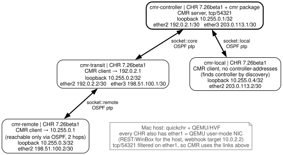

# cmr — four RouterOS routers, OSPF and a CMR controller

**Status:** ⚠ Beta lab · manual only · not part of the routine CI smoke subset

**Validated against:** RouterOS 7.26beta5 (default), x86 CHR. Earlier builds with
`--version`; what changed per build is in [FINDINGS.md](./FINDINGS.md).

This example is also quickchr's **CMR grounding lab**. CMR is still in beta, so
the lab pins a build, keeps [studies](#grounding-studies) that answer one question
each on a fresh lab, and records the answers per build in
[FINDINGS.md](./FINDINGS.md). Other projects (centrs, the `routeros-cmr` skill)
cite that file instead of keeping their own CMR notes.

## What it does

Builds four disposable CHRs using quickchr's named socket links. The controller
installs the optional `cmr` package; the other routers use the built-in client.
OSPF carries the controller loopback to a remote client through a transit router.
A directly attached client discovers CMR without `controller-addresses`.



Source: [topology.dot](./config/topology.dot).

Every link is its own `socket::<unique-name>` pair. Every router also has an
independent `ether1` user-mode NIC for host management. CMR TCP/54321 is dropped
inbound and reset outbound on that NIC, so CMR sessions use the socket topology.
The outbound reset matters: without it, a connect attempted while OSPF has no
route leaves via the user-mode default route and stalls for a SYN timeout.
The remote client connects to `10.255.0.1`, with an asserted active OSPF route
through the transit router.
There is no physical-device access, TAP interface or host routing change.
Each router has a bridge loopback before CMR starts; see the first-bridge alert
finding in the evidence report.

The script pairs clients with `pairClient()` from
[`tool/pairing.ts`](./tool/pairing.ts) (controller approval first, then the
client's generated quickchr login; it records whether a build still needed the
half-pair repair, see [FINDINGS.md → Pairing](./FINDINGS.md#pairing)), applies
labels, pins the lab's upgrade rule, creates resource/reboot/interface/log/version
alerts, runs a nonce-bearing script on all four routers, and builds a topology.
The default demo verifies a connected HTTP webhook at an ephemeral host listener.
The extended probe stops and restarts the remote VM to check disconnect/reconnect
alerts and automatic reconnect without re-pairing. Resource rules
are enabled for exploration; the script does not force CPU/RAM/disk exhaustion.

## Run it

From this directory:

```sh
bun run cmr.ts --report /tmp/cmr-result.json
sh cmr.sh --report /tmp/cmr-cli-result.json
pwsh cmr.ps1 --report /tmp/cmr-powershell-result.json
```

The shell and PowerShell drivers select `--cli`: the shared runner invokes
`quickchr start --add-network socket::… --add-package cmr` and `quickchr exec`.
Read-back assertions use the library in both modes, avoiding duplicated assertions.
They require Bun as well as QEMU. `$QUICKCHR` defaults to the repo CLI and can
select an installed binary, following the other examples' invocation convention.

Expect several minutes on x86 KVM/HVF, longer under TCG. All four guests are
explicitly x86, so an Intel Mac uses HVF and Apple Silicon uses TCG. The free CHR
license is sufficient. The version is pinned (`DEFAULT_VERSION` in
[`tool/lab.ts`](./tool/lab.ts)); `--version 7.26beta1` or
`QUICKCHR_CMR_VERSION` reruns another build.

Add `--hold` to inspect the finished lab in WinBox 4 or WebFig. The script prints
machine names and WinBox ports; use `quickchr inspect <name>` locally for generated
login credentials. Ctrl-C in the hold phase removes all four VMs. Default runs
remove them on success or failure; report JSON survives teardown. Ctrl-C during
boot or probes stops after the current step and removes the VMs (a second Ctrl-C
removes them at once). Teardown looks machines up by name, so a VM restarted by
`--probe` is stopped too. Reports contain
lab state and webhook messages, never descriptors or pairing passwords.

For validated ad hoc commands in another terminal:

```sh
centrs retrieve --quickchr <machine-name> /cmr/device --json
centrs execute --quickchr <machine-name> --yes '/cmr/layout/rebuild-links [find name=lab]'
```

Add `--probe` for six fresh pairing combinations, command completion, default-rule
editing, package-directory syntax, export checks, a real binary-backup restore
and finally the remote outage.
These probes change only the disposable lab. A failing check exits nonzero;
`--report` saves the partial evidence and failure state before cleanup.

The lab configures upgrade rules but never calls `upgrade` or `trigger`.
WiFi requires radios and is outside this CHR example. VLAN provisioning and global server pairing policy remain open questions in FINDINGS.md.

`bun run cmr.ts --first-bridge` builds the fleet without bridges (loopbacks on
`lo`), to check the first-bridge alert that 7.26beta1 missed and 7.26beta3's
changelog says is fixed. The `recheck` study covers the same question on a pair
lab.

## Grounding studies

A study boots its own two-CHR lab (controller and one client on one socket link),
answers one question, and writes raw RouterOS output with `--report`. Studies
record rather than assert, so they fail only when the lab breaks.

```sh
bun run cmr.ts --study pairing --boots 3 --trials 12 --report /tmp/pairing.json
bun run cmr.ts --study policy --report /tmp/policy.json
bun run cmr.ts --study recheck --report /tmp/recheck.json
```

| Study | Question |
|---|---|
| `pairing` | Which pairing sequences leave a fresh client half-paired, how often, and is it per boot? Each trial checks `run-script` selection and then restarts the controller's CMR service to see whether the pairing was committed. `--strategies` picks from `credentialed`, `confirm-first`, `client-local`, `client-none`. |
| `policy` | What may a `run-script` line do on a client, compared with the manual's permission table, and which controller login groups may send one? |
| `recheck` | Do the 7.26beta1 findings (export, client `confirm`, first-interface alert, identity sync, default upgrade rule, disable/enable) still hold? |

Curated reports are kept under [`evidence/<build>/`](./evidence/).
[FINDINGS.md → Re-grounding a new build](./FINDINGS.md#re-grounding-a-new-build)
is the checklist for a new beta. To add a study, write a function in
[`tool/studies.ts`](./tool/studies.ts), register it in `STUDIES`, and give its
question a section in FINDINGS.md.

## If you copied only this directory

Replace `../../../src/index.ts` in `tool/lab.ts` and `tool/pairing.ts`, and
`../../src/index.ts` in `cmr.ts`, with `@tikoci/quickchr` (`bun add @tikoci/quickchr`). Copy
[../lib.ts](../lib.ts) and the CLI common helpers or inline the helpers you use.
For CLI mode set `QUICKCHR=quickchr` to use the installed package.

## Friction found

See [FINDINGS.md](./FINDINGS.md) for observed RouterOS behavior per build,
[REPORT.md](./REPORT.md) for the original 7.26beta1 record, and
[prepared support reports](./SUPPORT-REPORTS.md). This example deliberately uses bounded polling of CMR
state; host REST readiness alone does not prove pairing or OSPF convergence.

## See also

- [Coverage matrix](../COVERAGE.md)
- [CMR manual](https://manual.mikrotik.com/docs/management-tools/cmr/)
- [Shared CMR skill](https://github.com/tikoci/routeros-skills/blob/main/routeros-cmr/SKILL.md)
- [Amm0Bot's OSPF topology](https://forum.mikrotik.com/t/i-upgraded-a-chr-from-an-iphone-a-bots-eye-view-of-agentic-routeros-ops/273246/8)
